# Práctica 07 · Caso de estudio SonoraDB

| | |
| --- | --- |
| **Autor** | Álvaro García-Quismondo Lizana |
| **Programa** | Máster en IA y Big Data · Tajamar |
| **Motor** | SQL Server 2025 (17.0.1135.8 RTM) |
| **Herramienta** | SQL Server Management Studio 22 |
| **Base de datos** | `SonoraDB` (nivel de compatibilidad 170) |
| **Fecha** | 30/09/2026 |

Esta práctica repasa consultas básicas, funciones, agregaciones, `JOIN`, DDL y DML sobre `SonoraDB`, la base de datos que se usa durante todas las sesiones de SQL. Cada apartado incluye el enunciado, la consulta utilizada, la captura del resultado y, cuando el enunciado lo pide, la explicación.

---

## Preparación del entorno

### Paso 1. Comprobar la versión del motor

```sql
SELECT @@VERSION AS version_completa,
       SERVERPROPERTY('ProductMajorVersion') AS version_principal;
```

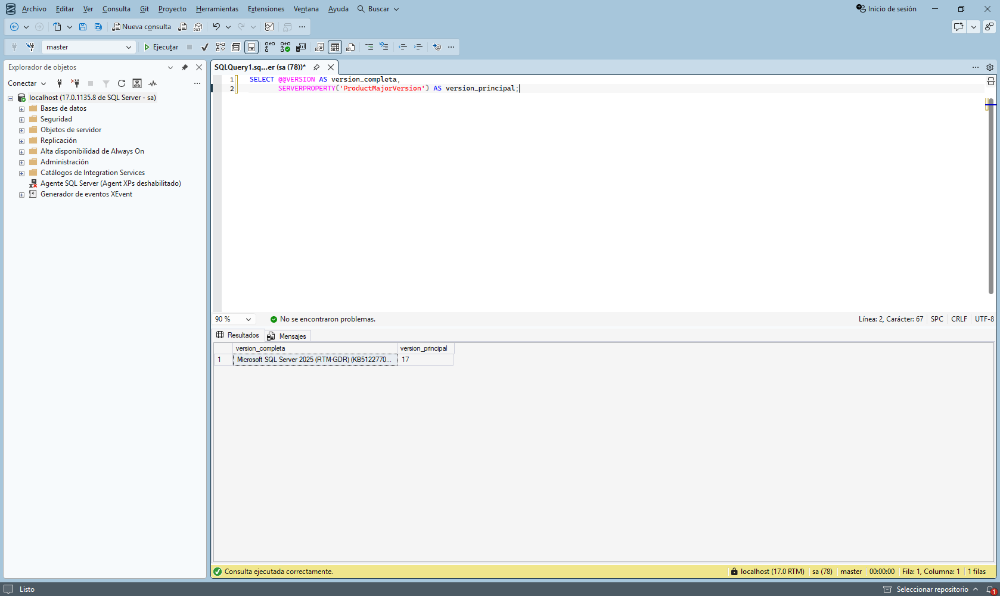

`version_principal` devuelve **17**, que corresponde a SQL Server 2025.

### Paso 2. Crear la base de datos con nivel de compatibilidad 170

```sql
USE master;
GO

IF DB_ID(N'SonoraDB') IS NOT NULL
BEGIN
    ALTER DATABASE SonoraDB SET SINGLE_USER WITH ROLLBACK IMMEDIATE;
    DROP DATABASE SonoraDB;
END;
GO

CREATE DATABASE SonoraDB;
GO

ALTER DATABASE SonoraDB SET COMPATIBILITY_LEVEL = 170;
GO

SELECT name, compatibility_level
FROM sys.databases
WHERE name = N'SonoraDB';
GO
```

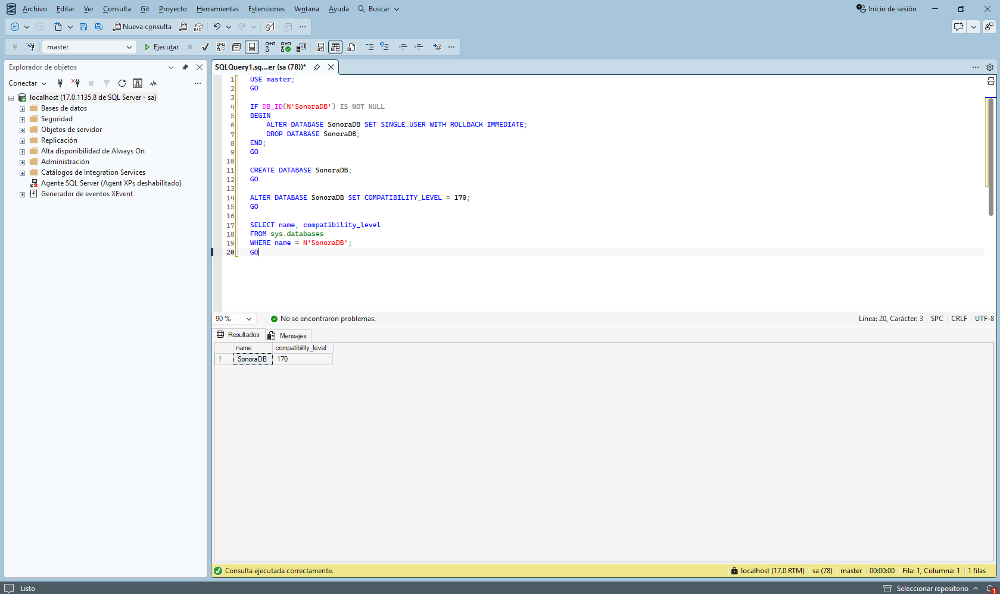

### Paso 3. Crear las tablas con sus claves primarias y foráneas

Se ejecuta sin cambios el script del enunciado, que crea en orden las tablas `generos`, `artistas`, `canciones`, `usuarios`, `reproducciones`, `empleados` y las dos tablas de staging (`stg_reproducciones` y `stg_usuarios`).

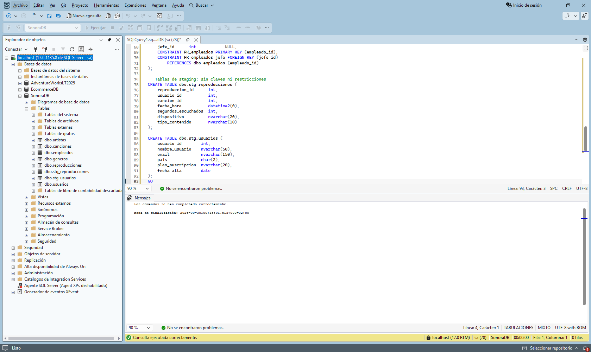

### Paso 4. Cargar los datos

Se ejecuta sin cambios el script de inserciones del enunciado, respetando el orden de las tablas para no violar ninguna clave foránea. Los mensajes confirman las filas insertadas en cada tabla: 13, 9, 15, 8, 33, 7, 4 y 10.

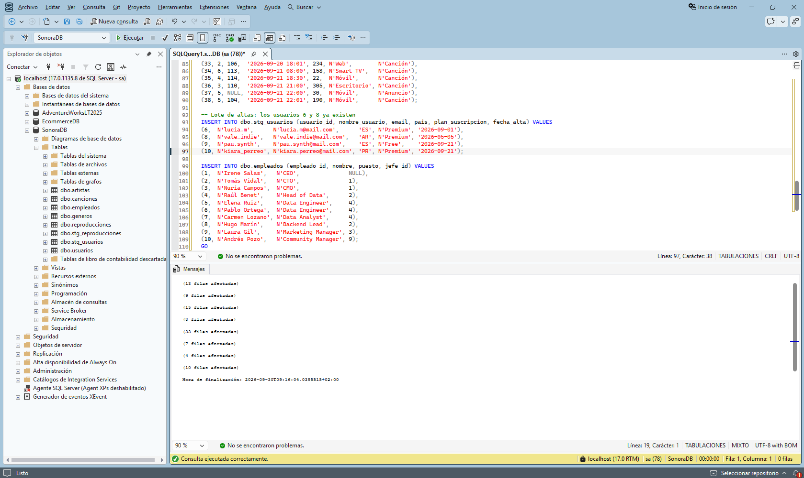

### Paso 5. Verificar la carga

```sql
SELECT 'generos' AS tabla, COUNT(*) AS filas FROM dbo.generos
UNION ALL SELECT 'artistas', COUNT(*) FROM dbo.artistas
UNION ALL SELECT 'canciones', COUNT(*) FROM dbo.canciones
UNION ALL SELECT 'usuarios', COUNT(*) FROM dbo.usuarios
UNION ALL SELECT 'reproducciones', COUNT(*) FROM dbo.reproducciones
UNION ALL SELECT 'stg_reproducciones', COUNT(*) FROM dbo.stg_reproducciones
UNION ALL SELECT 'stg_usuarios', COUNT(*) FROM dbo.stg_usuarios
UNION ALL SELECT 'empleados', COUNT(*) FROM dbo.empleados;
```

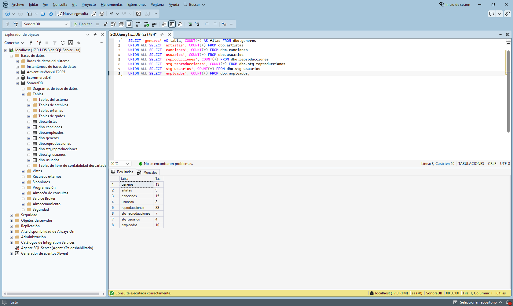

Los recuentos coinciden con los esperados: 13, 9, 15, 8, 33, 7, 4 y 10 filas.

---

## 1. Exploración de la base de datos

### Ejercicio 1 · Versión del motor y nivel de compatibilidad

> Comprueba que trabajas con SQL Server 2025 y que `SonoraDB` tiene el nivel de compatibilidad correcto. En una sola consulta, muestra la versión principal del motor (`SERVERPROPERTY`) y el nivel de compatibilidad de `SonoraDB` (`sys.databases`).

```sql
SELECT SERVERPROPERTY('ProductMajorVersion') AS version_principal,
       (SELECT compatibility_level
        FROM sys.databases
        WHERE name = N'SonoraDB') AS compatibility_level;
```

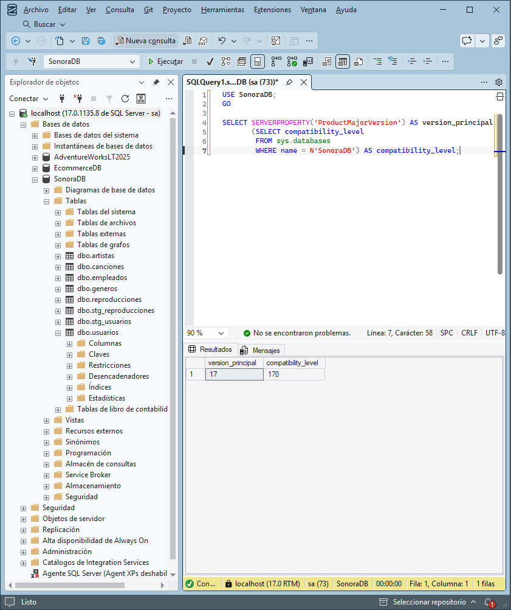

`SERVERPROPERTY` devuelve la versión principal del motor (17, SQL Server 2025) y la subconsulta lee en `sys.databases` el nivel de compatibilidad de `SonoraDB` (170).

### Ejercicio 2 · Tablas de usuario

> Lista los nombres de las tablas de usuario de `SonoraDB` usando la vista de catálogo `sys.tables`, ordenados alfabéticamente.

```sql
USE SonoraDB
GO

SELECT name
FROM sys.tables
ORDER BY name;
```

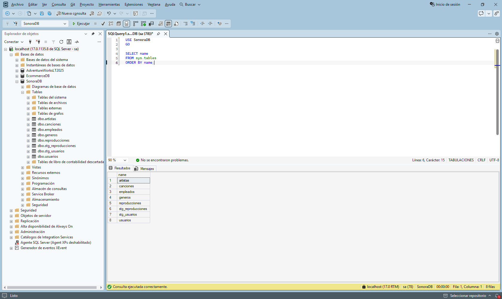

Salen las 8 tablas de la base de datos. Es importante estar conectado a `SonoraDB` (`USE SonoraDB`), porque `sys.tables` muestra las tablas de la base de datos activa.

### Ejercicio 3 · Columnas de `reproducciones`

> Usando `INFORMATION_SCHEMA.COLUMNS`, muestra las columnas de la tabla `reproducciones` con su tipo de dato, su longitud máxima y si admiten nulos, en el orden en que están definidas.

```sql
SELECT COLUMN_NAME,
       DATA_TYPE,
       CHARACTER_MAXIMUM_LENGTH,
       IS_NULLABLE
FROM INFORMATION_SCHEMA.COLUMNS
WHERE TABLE_NAME = 'reproducciones'
ORDER BY ORDINAL_POSITION;
```

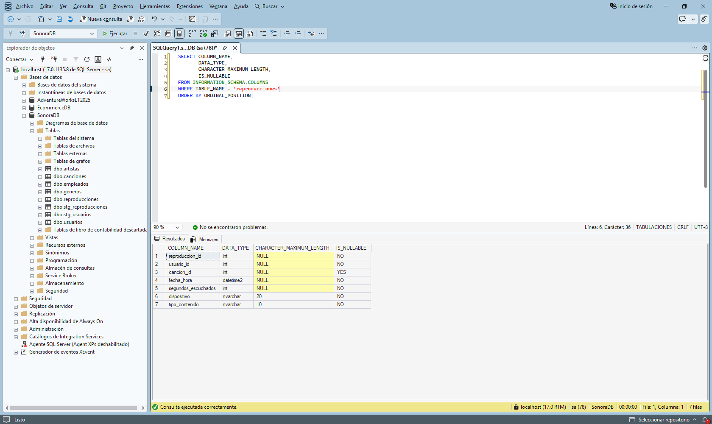

`ORDINAL_POSITION` es la posición de cada columna en la definición de la tabla. Solo los tipos de texto (`nvarchar`) tienen longitud máxima; en el resto aparece `NULL`. La única columna que admite nulos es `cancion_id`.

---

## 2. Consultas básicas: SELECT, WHERE y ORDER BY

### Ejercicio 4 · Usuarios de España

> Muestra el nombre de usuario, el plan y la fecha de alta de los usuarios de España (`ES`), del más antiguo al más reciente.

```sql
SELECT nombre_usuario,
       plan_suscripcion,
       fecha_alta
FROM dbo.usuarios
WHERE pais = 'ES'
ORDER BY fecha_alta ASC;
```

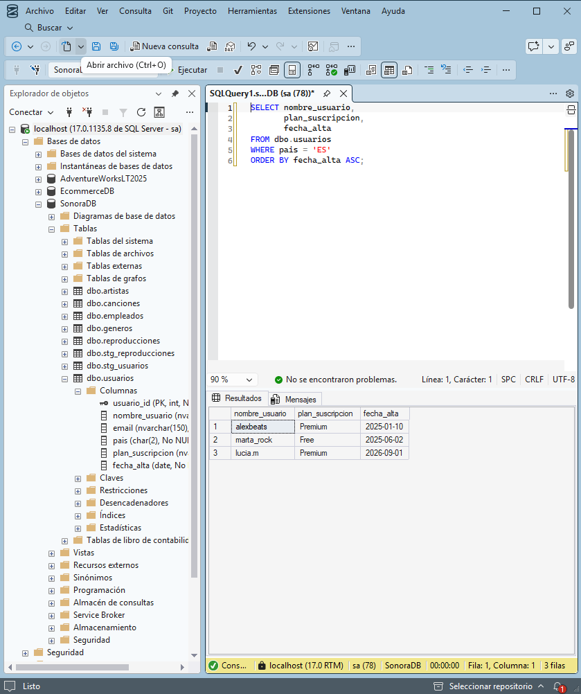

### Ejercicio 5 · Canciones de 2026 para la playlist de radio

> Canciones lanzadas en 2026 que duren entre 170 y 200 segundos (ambos incluidos). Muestra título, duración y fecha de lanzamiento, ordenadas por fecha. Filtra el año con un rango de fechas, sin aplicar funciones sobre la columna.

```sql
SELECT titulo,
       duracion_seg,
       fecha_lanzamiento
FROM dbo.canciones
WHERE (fecha_lanzamiento BETWEEN '2026-01-01' AND '2026-12-31')
AND (duracion_seg BETWEEN 170 AND 200)
ORDER BY fecha_lanzamiento ASC;
```

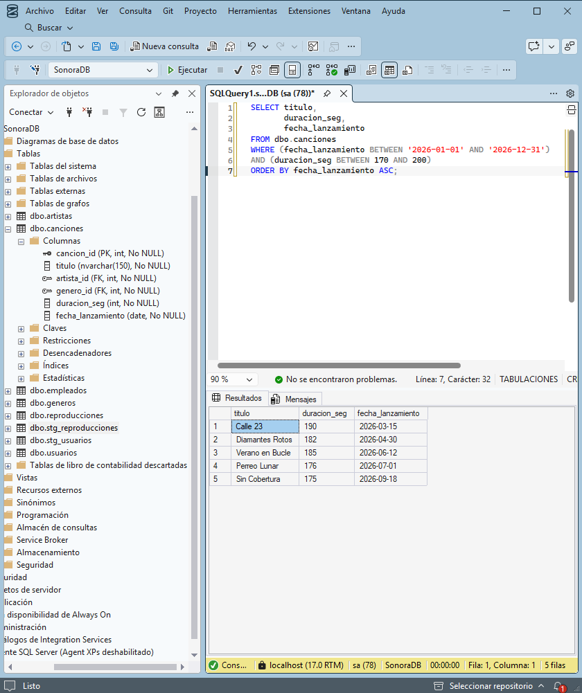

El año se filtra comparando la columna directamente con un rango de fechas, sin usar funciones como `YEAR()` sobre ella.

### Ejercicio 6 · Nombres de usuario con guion bajo

> Obtén los usuarios cuyo nombre de usuario contiene un guion bajo (`_`), ordenados alfabéticamente. Antes de escribir la solución correcta, prueba `LIKE '%_%'` y explica por qué devuelve los 8 usuarios.

Intento con `LIKE '%_%'`:

```sql
SELECT nombre_usuario
FROM dbo.usuarios
WHERE nombre_usuario LIKE '%_%';
```

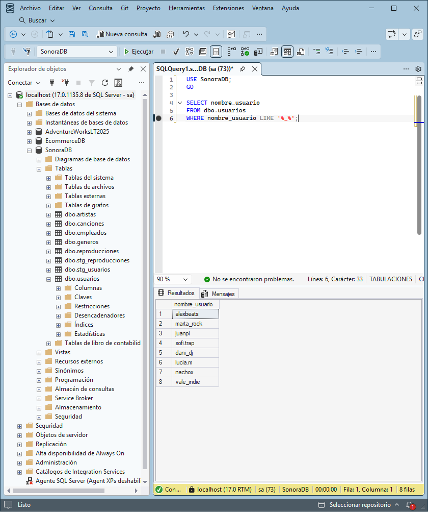

En `LIKE`, el guion bajo es un comodín que representa **un carácter cualquiera**, igual que `%` representa cero o más caracteres. Por tanto `'%_%'` significa "cualquier cadena con al menos un carácter", y la cumplen los 8 nombres de usuario.

Solución correcta, escapando el guion bajo para que se interprete como un carácter literal:

```sql
SELECT nombre_usuario
FROM dbo.usuarios
WHERE nombre_usuario LIKE '%\_%' ESCAPE '\'
ORDER BY nombre_usuario;
```

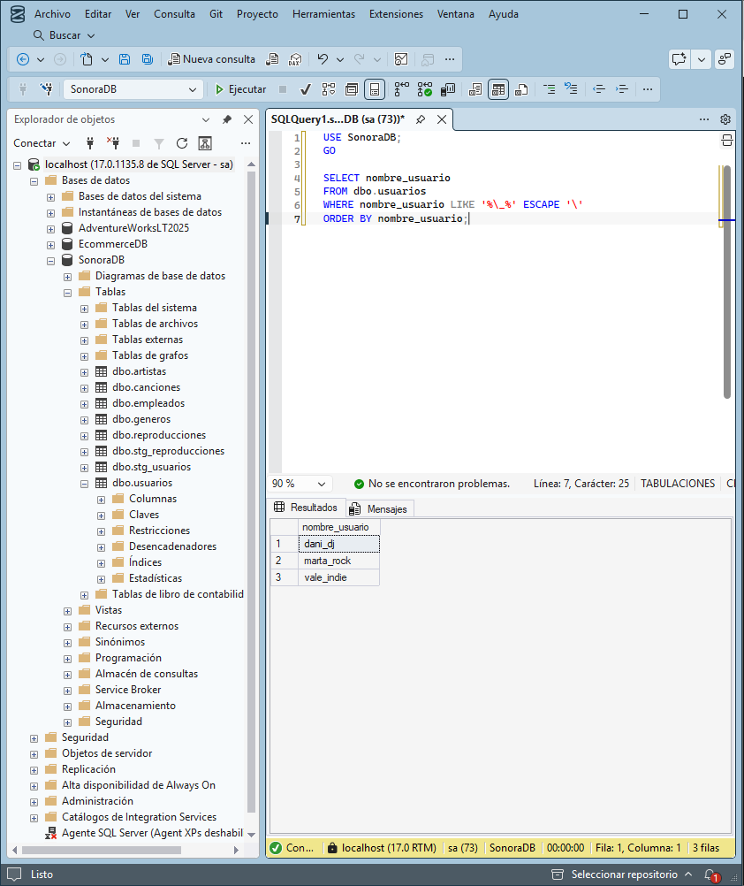

### Ejercicio 7 · Dispositivos utilizados

> ¿Desde qué dispositivos se han hecho reproducciones? Muestra cada dispositivo una sola vez, ordenado alfabéticamente.

```sql
SELECT DISTINCT dispositivo
FROM dbo.reproducciones
ORDER BY dispositivo ASC;
```

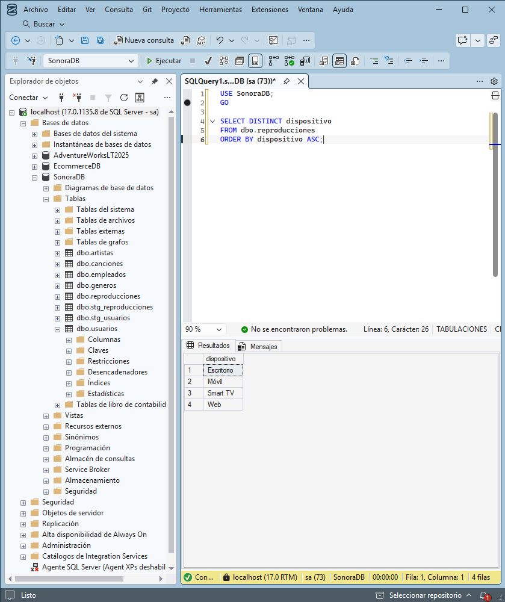

`DISTINCT` elimina los valores repetidos. La consulta se hace sobre `dbo.reproducciones`, que es la tabla de hechos, y no sobre la tabla de staging.

### Ejercicio 8 · Anuncios (`cancion_id` nulo)

> Lista las reproducciones que corresponden a anuncios filtrando por la columna `cancion_id`. Muestra el id de reproducción, el usuario y la fecha y hora. Comprueba también qué devuelve la condición `cancion_id = NULL` y explica el resultado.

```sql
SELECT reproduccion_id,
       usuario_id,
       fecha_hora
FROM dbo.reproducciones
WHERE cancion_id IS NULL;
```

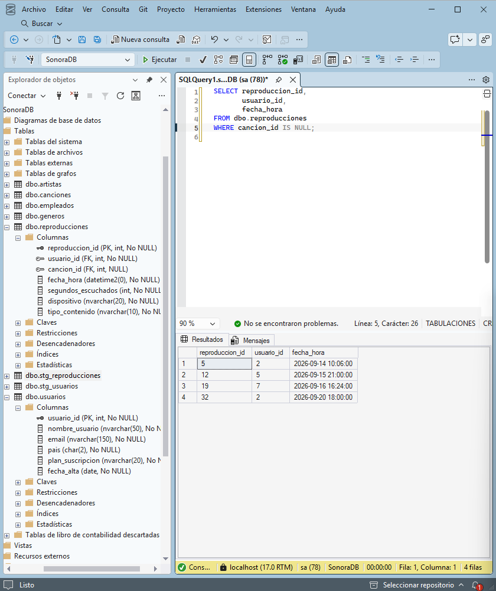

Comprobación con `= NULL`:

```sql
SELECT reproduccion_id,
       usuario_id,
       fecha_hora
FROM dbo.reproducciones
WHERE cancion_id = NULL;
```

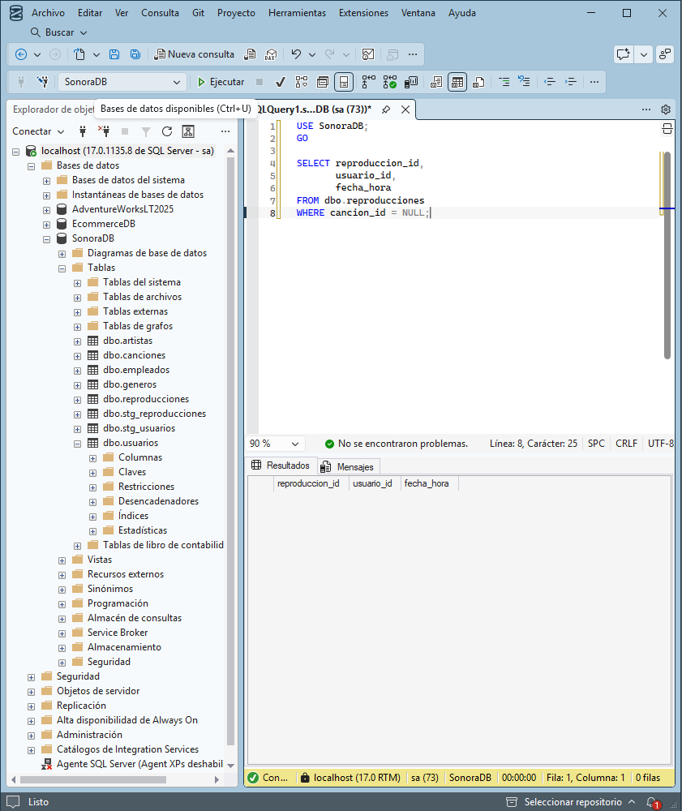

`NULL` significa "valor desconocido", no "vacío" ni "cero". Comparar cualquier valor con un desconocido, incluso otro `NULL`, no da verdadero ni falso sino `UNKNOWN`, y el `WHERE` solo deja pasar las filas para las que la condición es verdadera. Por eso `cancion_id = NULL` devuelve 0 filas aunque haya 4 anuncios. Para preguntar por la ausencia de valor hay que usar `IS NULL` o `IS NOT NULL`.

### Ejercicio 9 · Las 2 reproducciones más largas, con empates

> Obtén las 2 reproducciones con más segundos escuchados, pero incluyendo cualquier otra que empate con la última. Muestra id de reproducción, usuario, canción y segundos escuchados.

```sql
SELECT TOP (2) WITH TIES
       reproduccion_id,
       usuario_id,
       cancion_id,
       segundos_escuchados
FROM dbo.reproducciones
ORDER BY segundos_escuchados DESC;
```

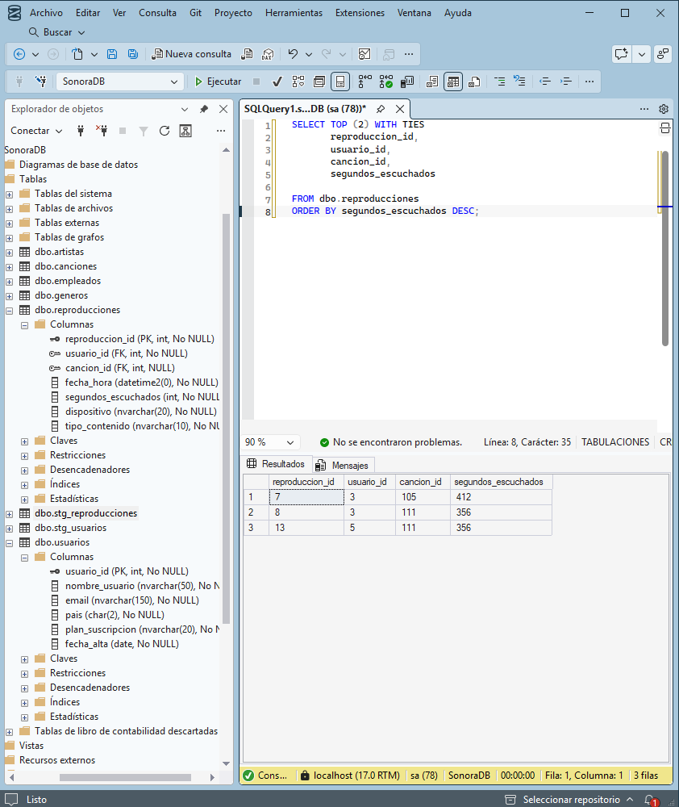

`TOP (2)` se queda con las dos primeras filas del orden indicado y `WITH TIES` añade las que empatan con la última. Como hay dos reproducciones de 356 segundos que ocupan la segunda posición, el resultado son 3 filas. `WITH TIES` exige un `ORDER BY`.

### Ejercicio 10 · Paginación del catálogo

> La app muestra el catálogo en páginas de 5 canciones ordenadas por título. Obtén los títulos de la **página 2** con `OFFSET ... FETCH`.

```sql
SELECT titulo
FROM dbo.canciones
ORDER BY titulo
OFFSET 5 ROWS FETCH NEXT 5 ROWS ONLY;
```

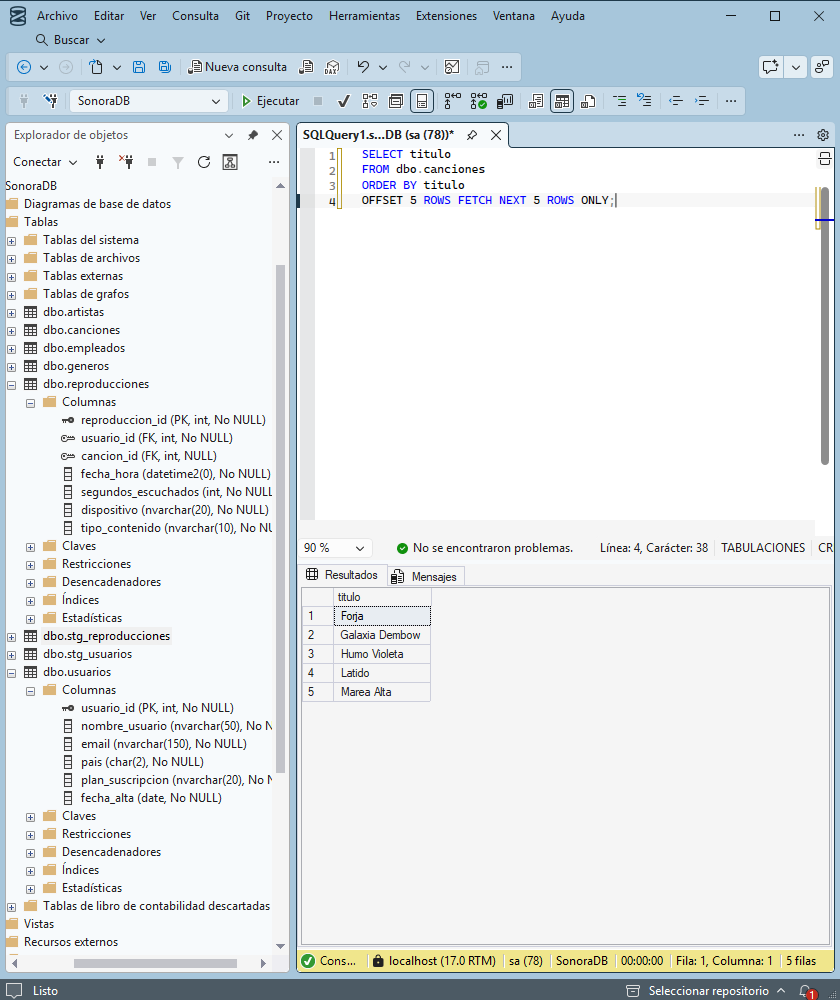

El desplazamiento se calcula como (página − 1) × tamaño de página = (2 − 1) × 5 = 5 filas que hay que saltar; después se toman las 5 siguientes.

---

## 3. Expresiones y funciones

### Ejercicio 11 · Clasificación por duración

> Clasifica las canciones de Nébula (artista 5) por duración: `Corta` si dura menos de 180 segundos, `Media` si dura entre 180 y 240 (ambos incluidos) y `Larga` si dura más de 240. Ordena por título.

```sql
SELECT titulo,
       duracion_seg,
       CASE
          WHEN duracion_seg < 180 THEN 'Corta'
          WHEN duracion_seg BETWEEN 180 AND 240 THEN 'Media'
          ELSE 'Larga'
       END AS categoria
FROM dbo.canciones
WHERE artista_id = 5
ORDER BY titulo;
```

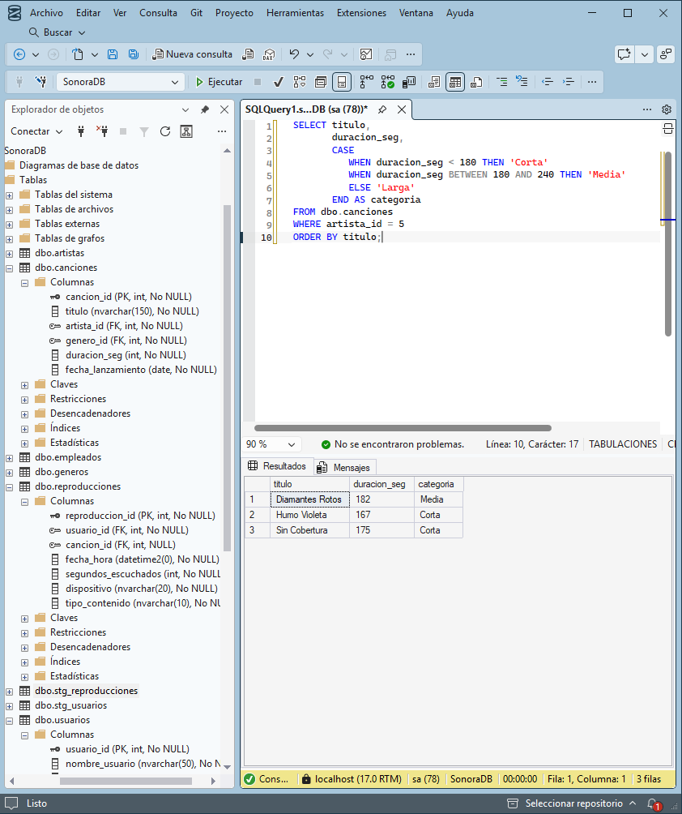

### Ejercicio 12 · Etiqueta de artista y longitud del nombre

> Para la ficha de artista de la app, genera una etiqueta con el formato `Nombre (PAÍS)` y la longitud del nombre en caracteres. Resuélvelo con `CONCAT` y después con el operador `||`, novedad de SQL Server 2025. Ordena por nombre.

Con `CONCAT`:

```sql
SELECT nombre,
       CONCAT(nombre, ' (', pais, ')') AS etiqueta,
       LEN(nombre) AS longitud
FROM dbo.artistas
ORDER BY nombre;
```

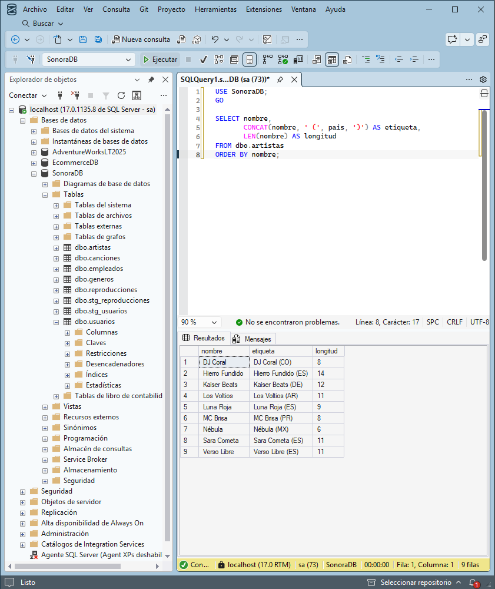

Con el operador `||`:

```sql
SELECT nombre,
       nombre || ' (' || pais || ')' AS etiqueta,
       LEN(nombre) AS longitud
FROM dbo.artistas
ORDER BY nombre;
```

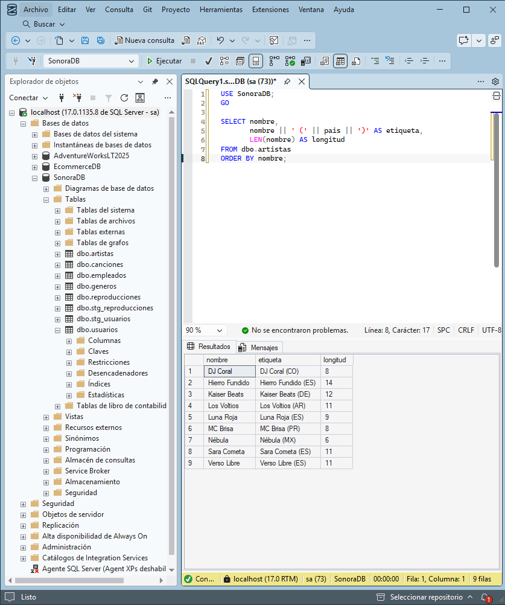

Las dos versiones producen el mismo resultado. `LEN` devuelve el número de caracteres del nombre.

### Ejercicio 13 · Antigüedad de los usuarios

> Calcula la antigüedad en días de cada usuario a fecha de 24/09/2026, ordenados de más a menos antiguo.

```sql
SELECT nombre_usuario,
       fecha_alta,
       DATEDIFF(day, fecha_alta, '2026-09-24') AS dias_antiguedad
FROM dbo.usuarios
ORDER BY fecha_alta;
```

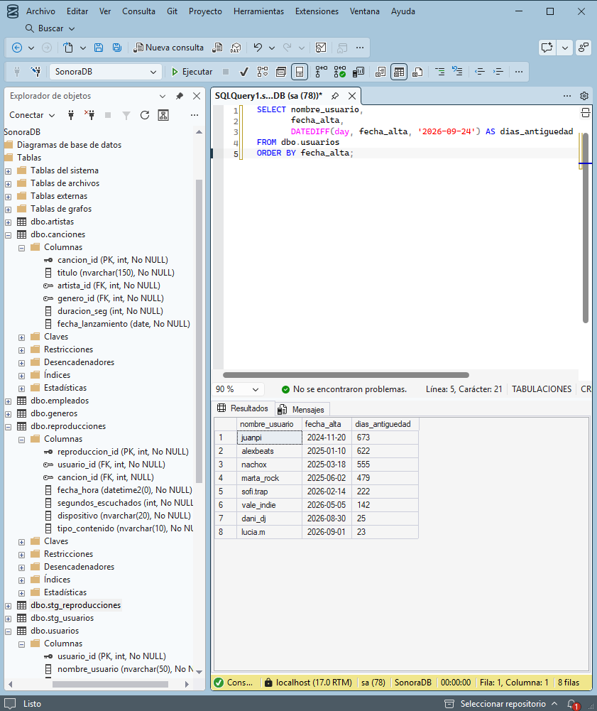

`DATEDIFF(unidad, fecha_inicio, fecha_fin)` cuenta las unidades entre las dos fechas. El orden de los argumentos importa: con la fecha fija en primer lugar saldrían valores negativos.

### Ejercicio 14 · Fecha y hora por separado

> Para las reproducciones del usuario 3, separa `fecha_hora` en dos columnas: la fecha (`date`) y la hora sin fracciones de segundo (`time(0)`). Muestra también los segundos escuchados. Ordena por fecha y hora.

```sql
SELECT reproduccion_id,
       CAST(fecha_hora AS date)    AS fecha,
       CAST(fecha_hora AS time(0)) AS hora,
       segundos_escuchados
FROM dbo.reproducciones
WHERE usuario_id = 3
ORDER BY fecha_hora;
```

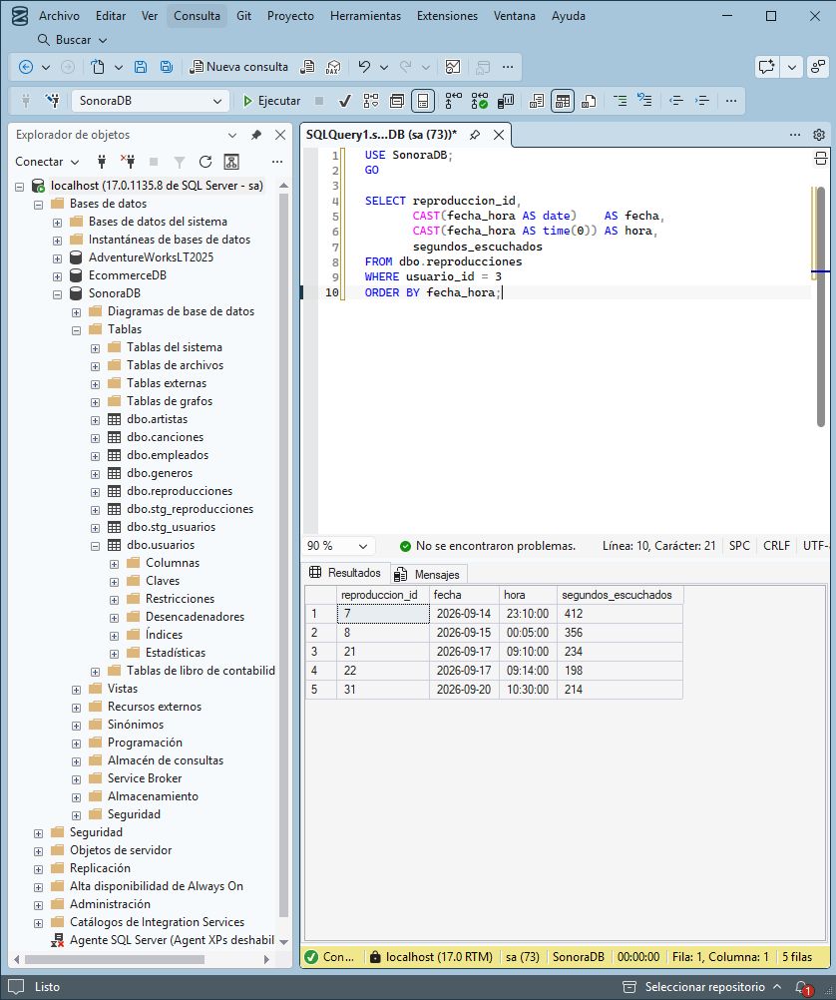

---

## 4. Funciones de agregación, GROUP BY y HAVING

### Ejercicio 15 · Resumen del catálogo

> Obtén un resumen del catálogo: número de canciones, duración mínima, duración máxima y duración media. Calcula la media dos veces, sobre la columna tal cual y forzando decimales, y explica la diferencia.

```sql
SELECT COUNT(*) AS num_canciones,
       MIN(duracion_seg) AS duracion_min,
       MAX(duracion_seg) AS duracion_max,
       AVG(duracion_seg) AS media_entera,
       AVG(CAST(duracion_seg AS decimal(10,6))) AS media_decimal
FROM dbo.canciones;
```

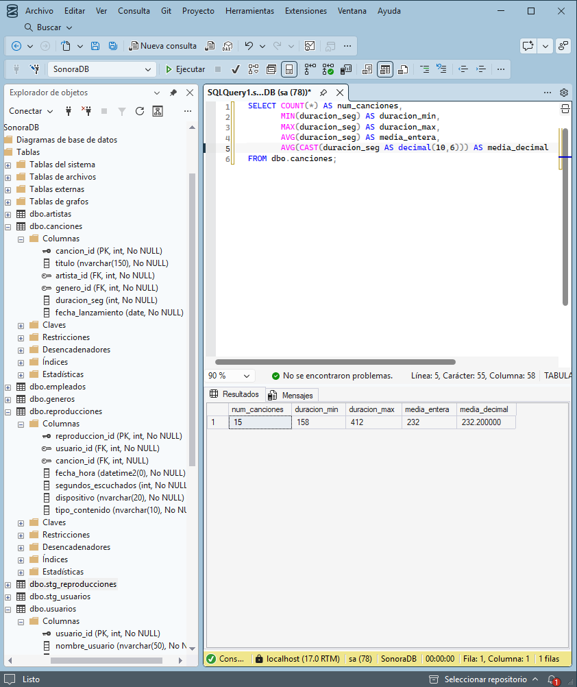

`duracion_seg` es de tipo `int`, y `AVG` sobre un `int` devuelve otro `int`, por lo que descarta la parte decimal: la suma de las duraciones es 3483 y, entre 15 canciones, la media real es 232,2, pero `media_entera` muestra 232. Al convertir la columna a `decimal(10,6)` **antes** de promediar, el resultado conserva los decimales (232,200000).

### Ejercicio 16 · Variantes de `COUNT`

> Sobre la tabla `reproducciones`, calcula en una sola consulta: `COUNT(*)`, `COUNT(cancion_id)`, el número de canciones distintas reproducidas y el número de usuarios distintos. Explica por qué las dos primeras cifras no coinciden.

```sql
SELECT COUNT(*) AS total_filas,
       COUNT(cancion_id) AS con_cancion,
       COUNT(DISTINCT cancion_id) AS canciones_distintas,
       COUNT(DISTINCT usuario_id) AS usuarios_distintos
FROM dbo.reproducciones;
```

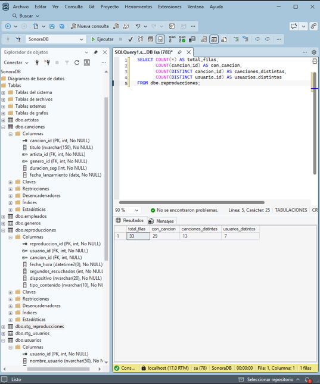

`COUNT(*)` cuenta filas, tengan o no valores nulos: las 33 reproducciones. `COUNT(cancion_id)` ignora los `NULL`: como 4 reproducciones son anuncios y tienen `cancion_id` nulo, cuenta 29 (33 − 4). `COUNT(DISTINCT ...)` cuenta valores distintos no nulos: hay 13 canciones distintas reproducidas (de las 15 del catálogo) y 7 usuarios distintos (de los 8 existentes).

### Ejercicio 17 · Actividad por dispositivo

> Para cada dispositivo, obtén el número de reproducciones (de cualquier tipo), el total de segundos y el total de minutos con un decimal. Ordena por número de reproducciones de mayor a menor.

```sql
SELECT dispositivo,
       COUNT(*) AS reproducciones,
       SUM(segundos_escuchados) AS segundos,
       ROUND(SUM(segundos_escuchados) / 60.0, 1) AS minutos
FROM dbo.reproducciones
GROUP BY dispositivo
ORDER BY reproducciones DESC;
```

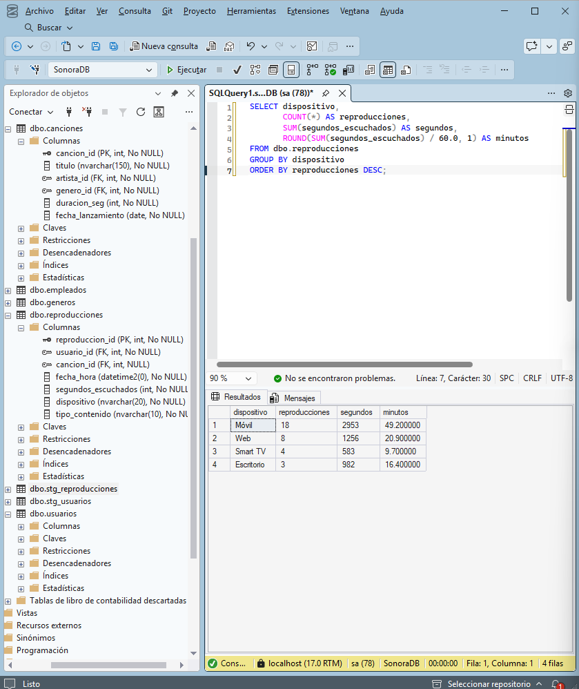

Se divide entre `60.0` (y no entre `60`) para evitar la división entera y conservar el decimal.

### Ejercicio 18 · Categorías de duración en todo el catálogo

> Usando la clasificación del Ejercicio 11 (`Corta`, `Media`, `Larga`) sobre **todo** el catálogo, obtén cuántas canciones hay en cada categoría y su duración media. Ordena por número de canciones descendente y por categoría.

```sql
SELECT CASE
           WHEN duracion_seg < 180 THEN 'Corta'
           WHEN duracion_seg BETWEEN 180 AND 240 THEN 'Media'
           ELSE 'Larga'
       END AS categoria,
       COUNT(*) AS num_canciones,
       AVG(duracion_seg) AS duracion_media
FROM dbo.canciones
GROUP BY CASE
             WHEN duracion_seg < 180 THEN 'Corta'
             WHEN duracion_seg BETWEEN 180 AND 240 THEN 'Media'
             ELSE 'Larga'
         END
ORDER BY num_canciones DESC, categoria;
```

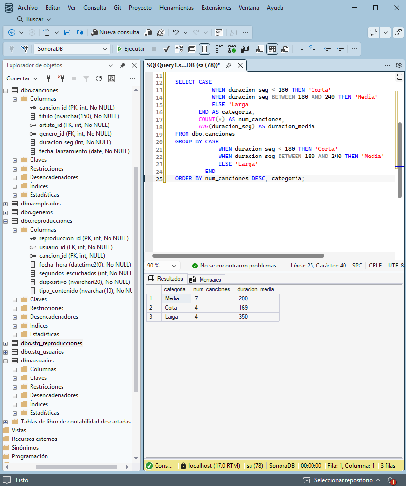

Como `GROUP BY` se evalúa antes que el `SELECT`, el alias `categoria` todavía no existe en ese momento, así que hay que repetir la expresión `CASE` completa. En `ORDER BY` sí se pueden usar los alias. Las medias salen truncadas por el mismo motivo que en el Ejercicio 15 (`AVG` sobre un `int`).

### Ejercicio 19 · Superoyentes

> Marketing busca "superoyentes": usuarios con más de 3 reproducciones de tipo `Canción` y más de 800 segundos escuchados en total. Muestra el nombre de usuario, el número de reproducciones y los segundos. Ordena por segundos de mayor a menor.

```sql
SELECT u.nombre_usuario,
       COUNT(*) AS reproducciones,
       SUM(r.segundos_escuchados) AS segundos
FROM dbo.reproducciones AS r
INNER JOIN dbo.usuarios AS u ON u.usuario_id = r.usuario_id
WHERE r.tipo_contenido = N'Canción'
GROUP BY u.usuario_id, u.nombre_usuario
HAVING COUNT(*) > 3
   AND SUM(r.segundos_escuchados) > 800
ORDER BY segundos DESC;
```

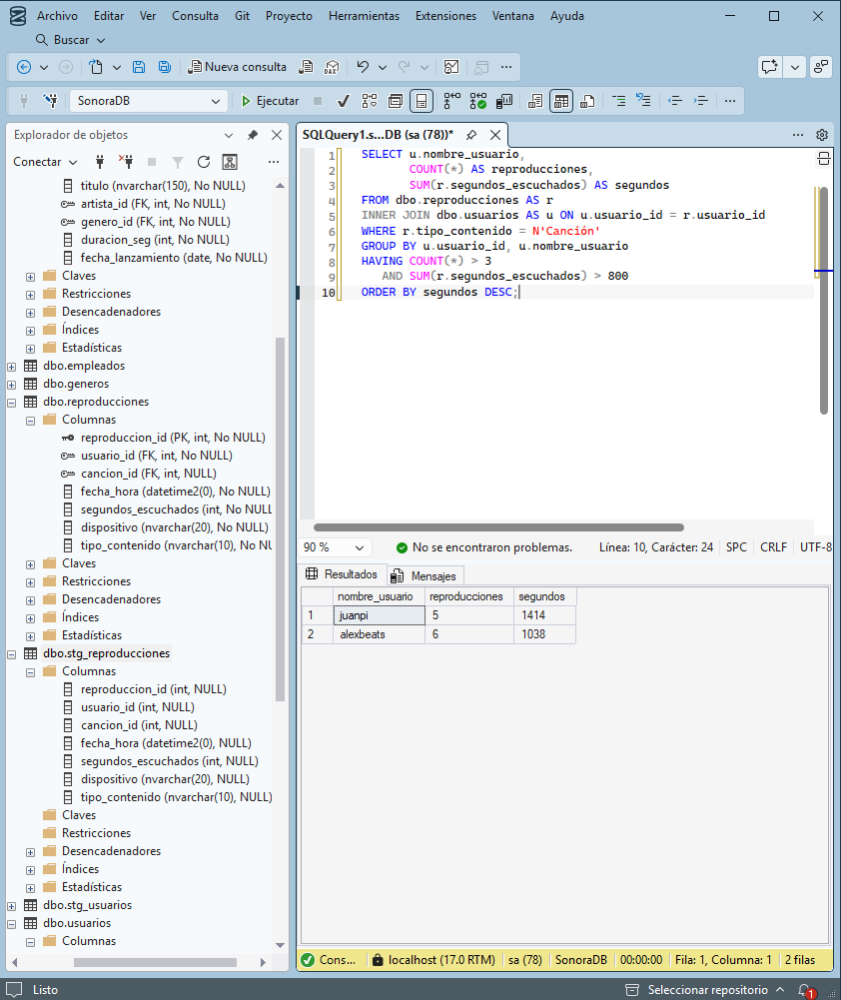

El tipo de contenido es una condición sobre **filas individuales**, así que va en el `WHERE` (se aplica antes de agrupar). El número de reproducciones y la suma de segundos son condiciones sobre **grupos**, así que van en el `HAVING` (se aplican después de agrupar).

### Ejercicio 20 · Reproducciones por plan y tipo de contenido

> Obtén el número de reproducciones por plan de suscripción y tipo de contenido. Ordena por plan y tipo.

```sql
SELECT u.plan_suscripcion,
       r.tipo_contenido,
       COUNT(*) AS reproducciones
FROM dbo.reproducciones AS r
INNER JOIN dbo.usuarios AS u ON u.usuario_id = r.usuario_id
GROUP BY u.plan_suscripcion, r.tipo_contenido
ORDER BY u.plan_suscripcion, r.tipo_contenido;
```

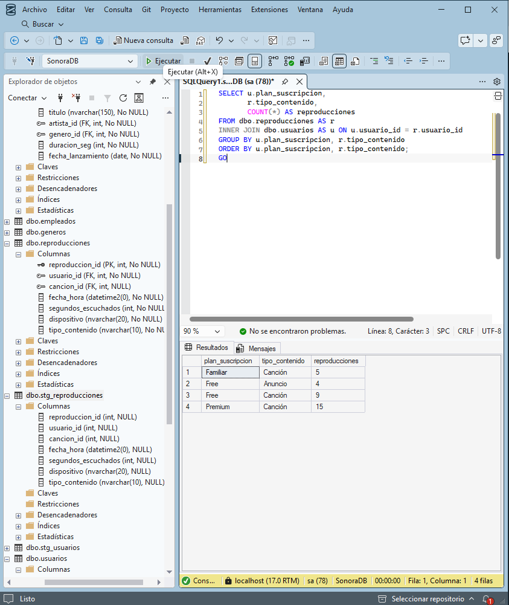

---

## 5. JOIN y UNION

### Ejercicio 21 · Canciones de artistas españoles

> Lista las canciones de artistas españoles con el nombre del artista y el nombre del género de la canción. Ordena por artista y título.

```sql
SELECT a.nombre AS artista,
       c.titulo,
       g.nombre AS genero
FROM dbo.canciones AS c
INNER JOIN dbo.artistas AS a ON a.artista_id = c.artista_id
INNER JOIN dbo.generos  AS g ON g.genero_id  = c.genero_id
WHERE a.pais = 'ES'
ORDER BY a.nombre, c.titulo;
```

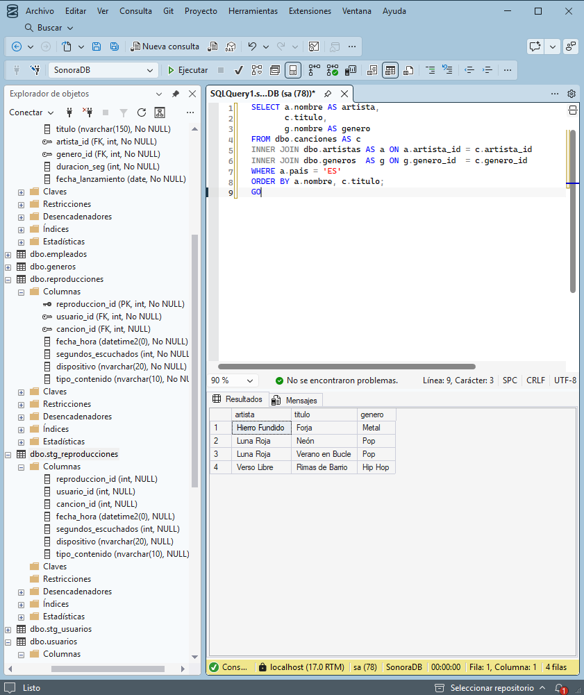

El género que se muestra es el de la canción (`c.genero_id`), no el del artista.

### Ejercicio 22 · Actividad del 16/09/2026

> Muestra la actividad del 16/09/2026 con `INNER JOIN`: hora, usuario, título y artista, ordenada por fecha y hora. Filtra el día con un rango de fechas.

```sql
SELECT r.fecha_hora,
       u.nombre_usuario,
       c.titulo,
       a.nombre AS artista
FROM dbo.reproducciones AS r
INNER JOIN dbo.usuarios  AS u ON u.usuario_id  = r.usuario_id
INNER JOIN dbo.canciones AS c ON c.cancion_id  = r.cancion_id
INNER JOIN dbo.artistas  AS a ON a.artista_id  = c.artista_id
WHERE r.fecha_hora >= '2026-09-16'
  AND r.fecha_hora <  '2026-09-17'
ORDER BY r.fecha_hora;
```

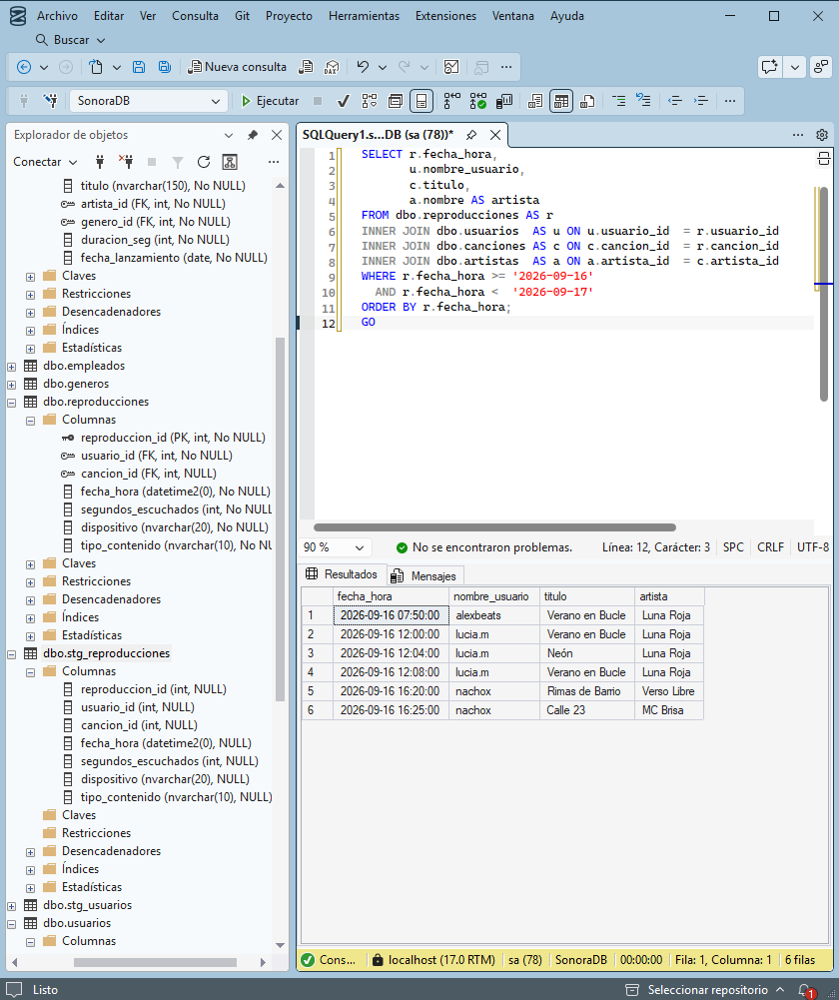

El día se filtra con un rango semiabierto (`>=` el día y `<` el día siguiente), que abarca todas las horas sin aplicar funciones sobre `fecha_hora`.

### Ejercicio 23 · La fila que falta

> Ese día hubo 7 reproducciones, pero el Ejercicio 22 solo devuelve 6. Explica qué fila falta y por qué. Reescribe la consulta para que aparezcan todas, mostrando `(Anuncio)` en el título y `-` en el artista cuando no haya canción.

La fila que falta es la reproducción 19 (16:24, usuario `nachox`), que es un **anuncio**: su `cancion_id` es `NULL`. Un `INNER JOIN` solo devuelve las filas que tienen pareja en la otra tabla, y `NULL` no es igual a ningún `cancion_id`, así que esa fila se descarta. Con `LEFT JOIN` se conservan todas las reproducciones, y `ISNULL` sustituye los valores nulos por el texto pedido.

```sql
SELECT r.fecha_hora,
       u.nombre_usuario,
       ISNULL(c.titulo, N'(Anuncio)') AS titulo,
       ISNULL(a.nombre, N'-')         AS artista
FROM dbo.reproducciones AS r
INNER JOIN dbo.usuarios  AS u ON u.usuario_id = r.usuario_id
LEFT  JOIN dbo.canciones AS c ON c.cancion_id = r.cancion_id
LEFT  JOIN dbo.artistas  AS a ON a.artista_id = c.artista_id
WHERE r.fecha_hora >= '2026-09-16'
  AND r.fecha_hora <  '2026-09-17'
ORDER BY r.fecha_hora;
```

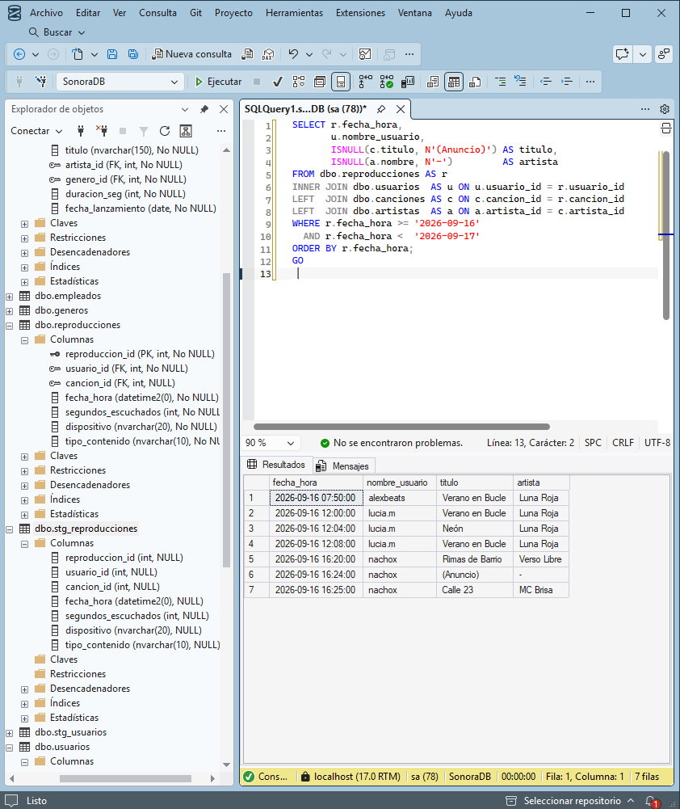

### Ejercicio 24 · Usuarios sin reproducciones

> Con `LEFT JOIN` e `IS NULL`, obtén los usuarios que no tienen ninguna reproducción. Muestra el nombre de usuario, el plan y la fecha de alta.

```sql
SELECT u.nombre_usuario, u.plan_suscripcion, u.fecha_alta
FROM dbo.usuarios AS u
LEFT JOIN dbo.reproducciones AS r ON r.usuario_id = u.usuario_id
WHERE r.reproduccion_id IS NULL;
```

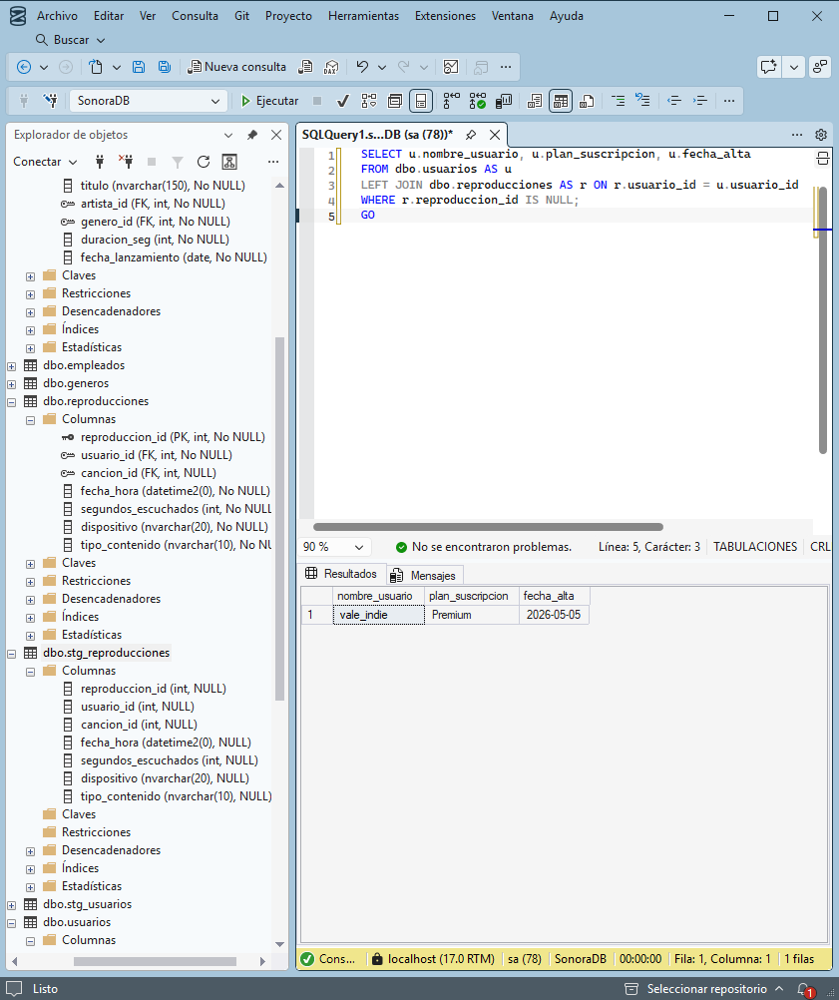

Es el patrón de antijoin: el `LEFT JOIN` conserva todos los usuarios y, para los que no tienen reproducciones, las columnas de `reproducciones` salen a `NULL`. El filtro `IS NULL` deja solo esos.

### Ejercicio 25 · Reproducciones por artista

> Obtén el número de reproducciones de cada artista, **incluidos los que no tienen ninguna**. Ordena por reproducciones descendente y por nombre. Después cambia el conteo a `COUNT(*)` y explica por qué Sara Cometa pasa a tener 1.

```sql
SELECT a.nombre AS artista,
       COUNT(r.reproduccion_id) AS reproducciones
FROM dbo.artistas AS a
LEFT JOIN dbo.canciones      AS c ON c.artista_id = a.artista_id
LEFT JOIN dbo.reproducciones AS r ON r.cancion_id = c.cancion_id
GROUP BY a.artista_id, a.nombre
ORDER BY reproducciones DESC, a.nombre;
```

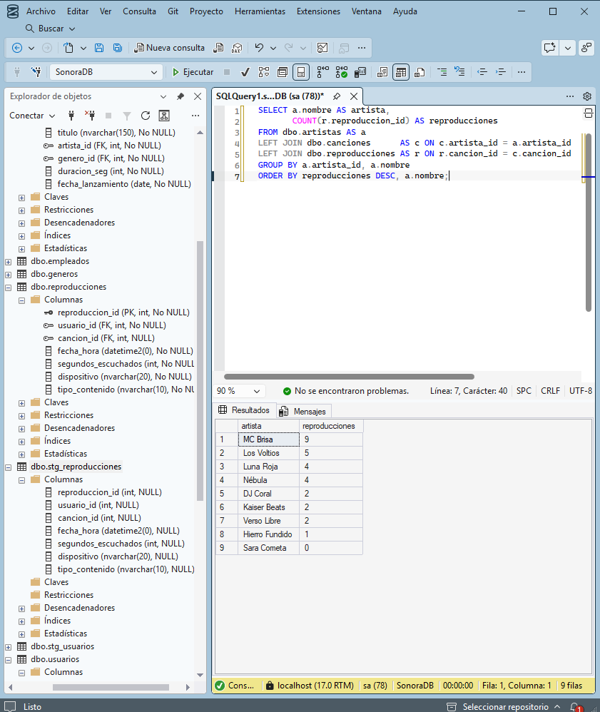

Con `COUNT(*)`:

```sql
SELECT a.nombre AS artista,
       COUNT(*) AS reproducciones
FROM dbo.artistas AS a
LEFT JOIN dbo.canciones      AS c ON c.artista_id = a.artista_id
LEFT JOIN dbo.reproducciones AS r ON r.cancion_id = c.cancion_id
GROUP BY a.artista_id, a.nombre
ORDER BY reproducciones DESC, a.nombre;
```

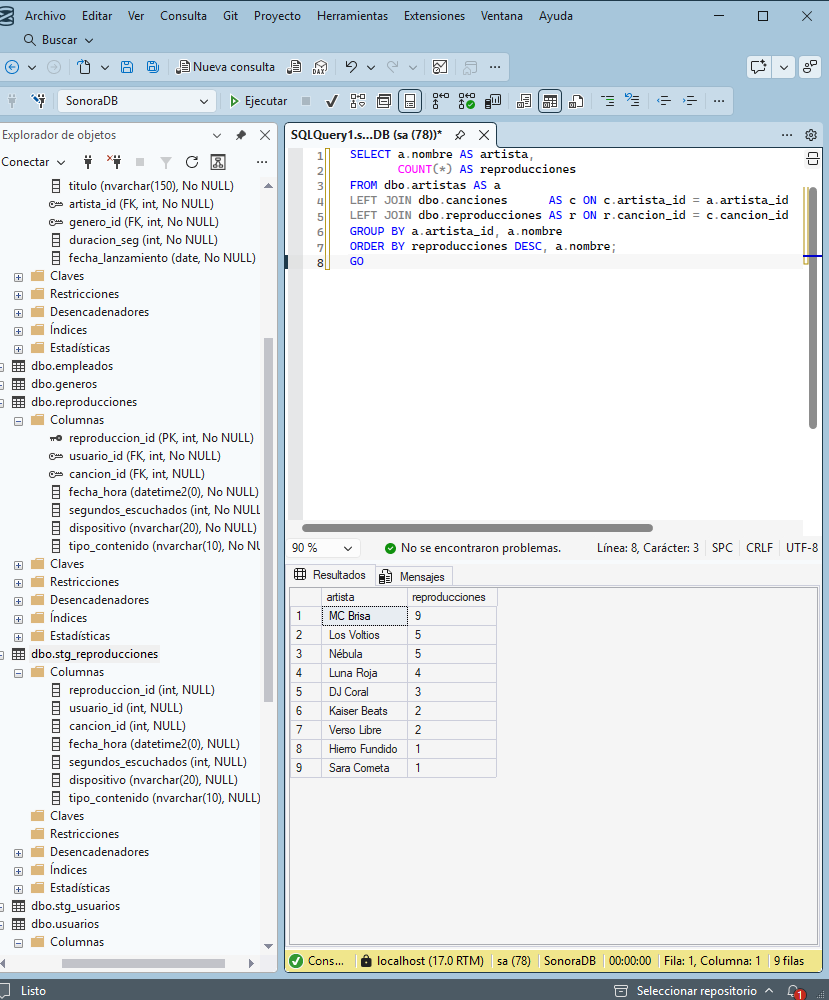

Sara Cometa no tiene canciones, así que el `LEFT JOIN` genera para ella **una fila** con todas las columnas de `canciones` y `reproducciones` a `NULL`. `COUNT(*)` cuenta filas, incluida esa fila vacía, y da 1; `COUNT(r.reproduccion_id)` cuenta solo valores no nulos y da 0, que es el valor correcto. Por el mismo motivo suben también Nébula (de 4 a 5) y DJ Coral (de 2 a 3): tienen una canción sin ninguna reproducción (`Sin Cobertura` y `Latido`), que aporta una fila con `NULL`.

### Ejercicio 26 · Empleados y su jefe (self join)

> Con un self join sobre `empleados`, muestra cada empleado con su puesto y el nombre de su jefe directo. Para quien no tiene jefe, muestra `(sin jefe)`. Ordena por id de empleado.

```sql
SELECT e.nombre AS empleado,
       e.puesto,
       ISNULL(j.nombre, N'(sin jefe)') AS jefe
FROM dbo.empleados AS e
LEFT JOIN dbo.empleados AS j ON j.empleado_id = e.jefe_id
ORDER BY e.empleado_id;
```

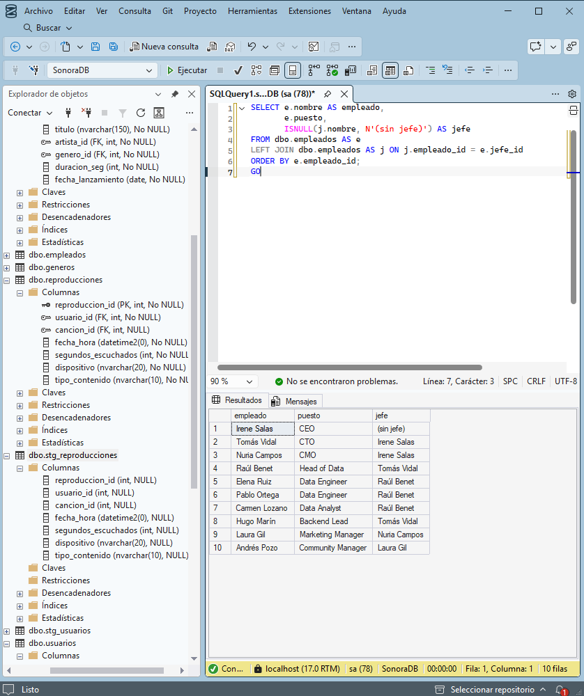

La tabla se usa dos veces con alias distintos: `e` para el empleado y `j` para su jefe. Se necesita `LEFT JOIN` para que la CEO, cuyo `jefe_id` es nulo, no desaparezca del resultado.

### Ejercicio 27 · Géneros con más de 3 reproducciones válidas

> Obtén los géneros (de la canción) con más de 3 reproducciones válidas, con el número de reproducciones y los minutos escuchados con un decimal. Ordena por reproducciones descendente.

Criterio aplicado para "reproducción válida": reproducciones de tipo `Canción` con **al menos 30 segundos escuchados** (se descartan los anuncios y las reproducciones abandonadas casi al instante).

```sql
SELECT g.nombre AS genero,
       COUNT(*) AS reproducciones_validas,
       ROUND(SUM(r.segundos_escuchados) / 60.0, 1) AS minutos
FROM dbo.reproducciones AS r
INNER JOIN dbo.canciones AS c ON c.cancion_id = r.cancion_id
INNER JOIN dbo.generos   AS g ON g.genero_id  = c.genero_id
WHERE r.tipo_contenido = N'Canción'
  AND r.segundos_escuchados >= 30
GROUP BY g.genero_id, g.nombre
HAVING COUNT(*) > 3
ORDER BY reproducciones_validas DESC;
```

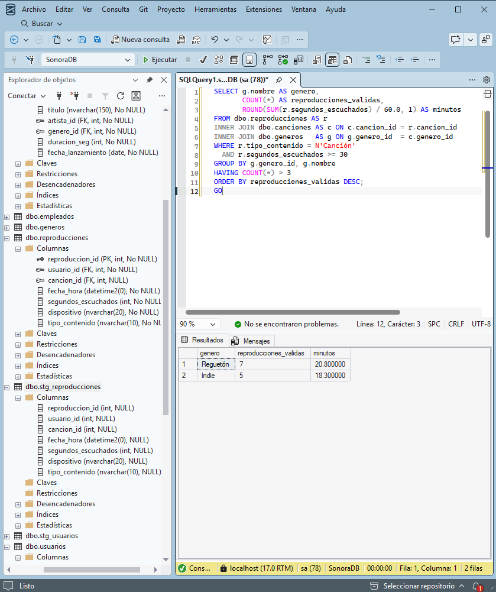

### Ejercicio 28 · Países con presencia: `UNION` y `UNION ALL`

> Sonora quiere saber en qué países tiene presencia, ya sea por artistas o por usuarios. Obtén la lista de países sin repetir, ordenada. Después cambia a `UNION ALL`, cuenta las filas y explica la diferencia.

Con `UNION`:

```sql
SELECT pais FROM dbo.artistas
UNION
SELECT pais FROM dbo.usuarios
ORDER BY pais;
```

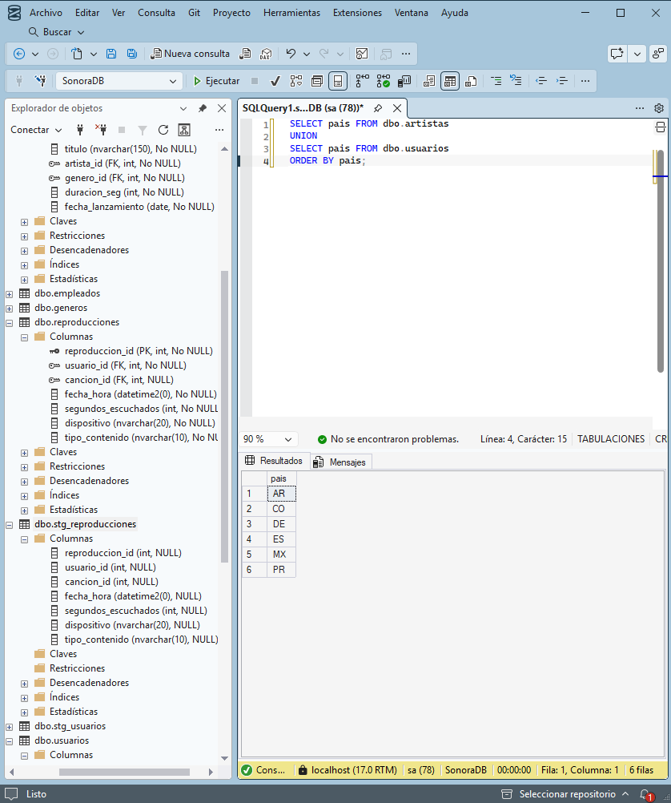

Con `UNION ALL`:

```sql
SELECT pais FROM dbo.artistas
UNION ALL
SELECT pais FROM dbo.usuarios;
```

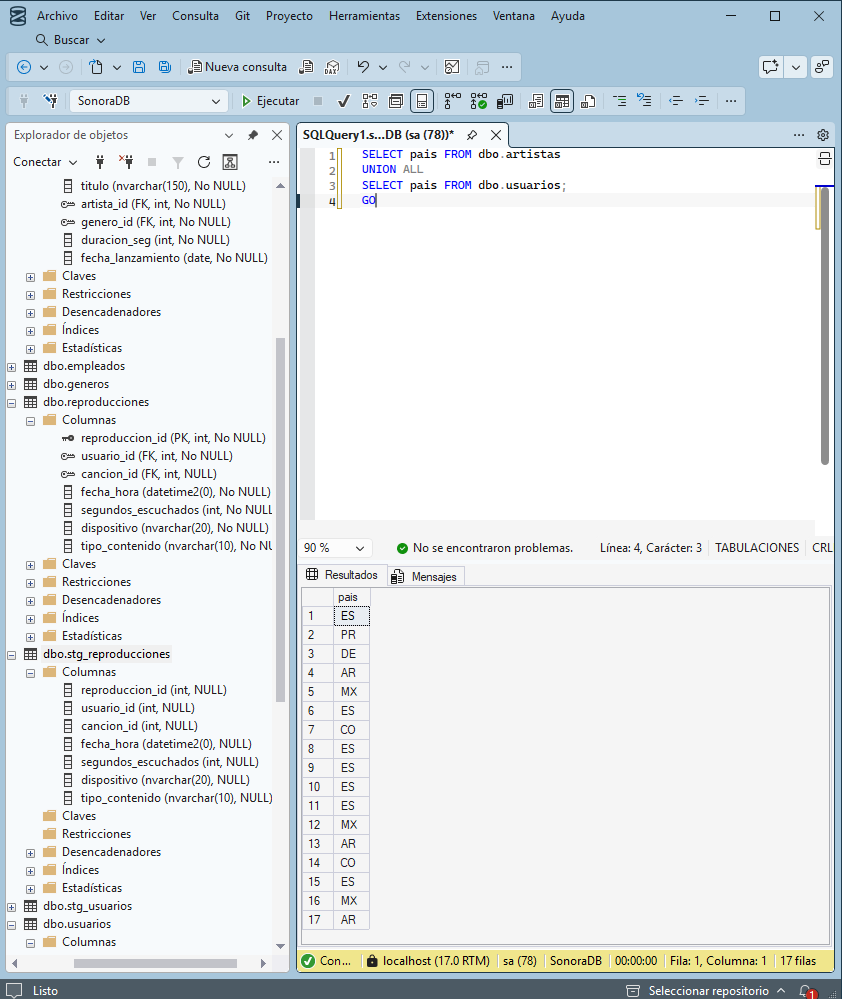

`UNION` combina los dos resultados y **elimina los duplicados**, por eso devuelve 6 países distintos. `UNION ALL` los concatena sin eliminar nada: 9 artistas + 8 usuarios = **17 filas**, con países repetidos. `UNION ALL` es más rápido porque no tiene que buscar duplicados, y es la opción correcta cuando no se quiere deduplicar.

---

## 6. DDL: crear y modificar tablas

### Ejercicio 29 · Tabla `playlists`

> Crea la tabla `dbo.playlists` con estas columnas y restricciones. Da nombre explícito a cada restricción. Además, un mismo usuario no puede tener dos playlists con el mismo nombre.

```sql
CREATE TABLE dbo.playlists (
    playlist_id     int           IDENTITY(1,1) NOT NULL,
    usuario_id      int           NOT NULL,
    nombre          nvarchar(100) NOT NULL,
    es_publica      bit           NOT NULL
        CONSTRAINT DF_playlists_es_publica DEFAULT 0,
    fecha_creacion  datetime2(0)  NOT NULL
        CONSTRAINT DF_playlists_fecha_creacion DEFAULT SYSDATETIME(),
    CONSTRAINT PK_playlists PRIMARY KEY (playlist_id),
    CONSTRAINT FK_playlists_usuarios FOREIGN KEY (usuario_id)
        REFERENCES dbo.usuarios (usuario_id),
    CONSTRAINT UQ_playlists_usuario_nombre UNIQUE (usuario_id, nombre)
);
GO
```

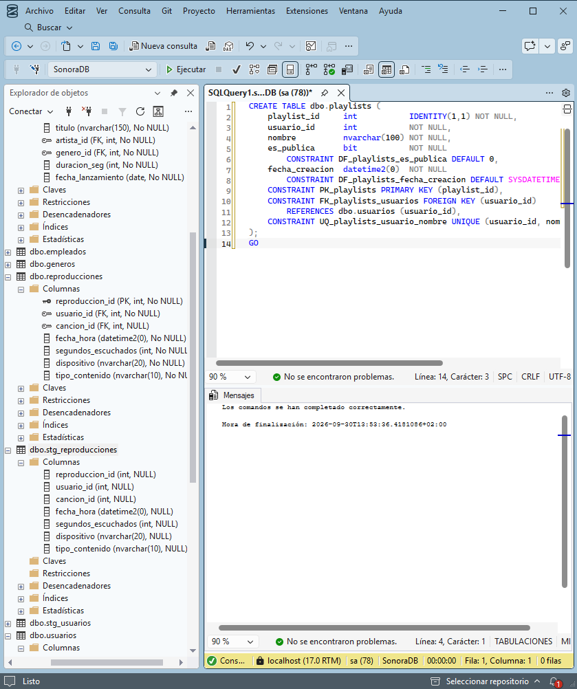

`IDENTITY(1,1)` hace la clave autonumérica a partir de 1. Los valores por defecto se definen con restricciones `DEFAULT` con nombre (`DF_...`), y la unicidad de (usuario, nombre) con `UQ_playlists_usuario_nombre`.

### Ejercicio 30 · Tabla `playlist_canciones`

> Crea la tabla `dbo.playlist_canciones`, que relaciona cada playlist con sus canciones. La clave primaria es compuesta (`playlist_id`, `cancion_id`): una canción no puede estar dos veces en la misma playlist.

```sql
CREATE TABLE dbo.playlist_canciones (
    playlist_id     int          NOT NULL,
    cancion_id      int          NOT NULL,
    fecha_agregada  datetime2(0) NOT NULL
        CONSTRAINT DF_playlist_canciones_fecha DEFAULT SYSDATETIME(),
    CONSTRAINT PK_playlist_canciones PRIMARY KEY (playlist_id, cancion_id),
    CONSTRAINT FK_playlist_canciones_playlists FOREIGN KEY (playlist_id)
        REFERENCES dbo.playlists (playlist_id),
    CONSTRAINT FK_playlist_canciones_canciones FOREIGN KEY (cancion_id)
        REFERENCES dbo.canciones (cancion_id)
);
GO
```

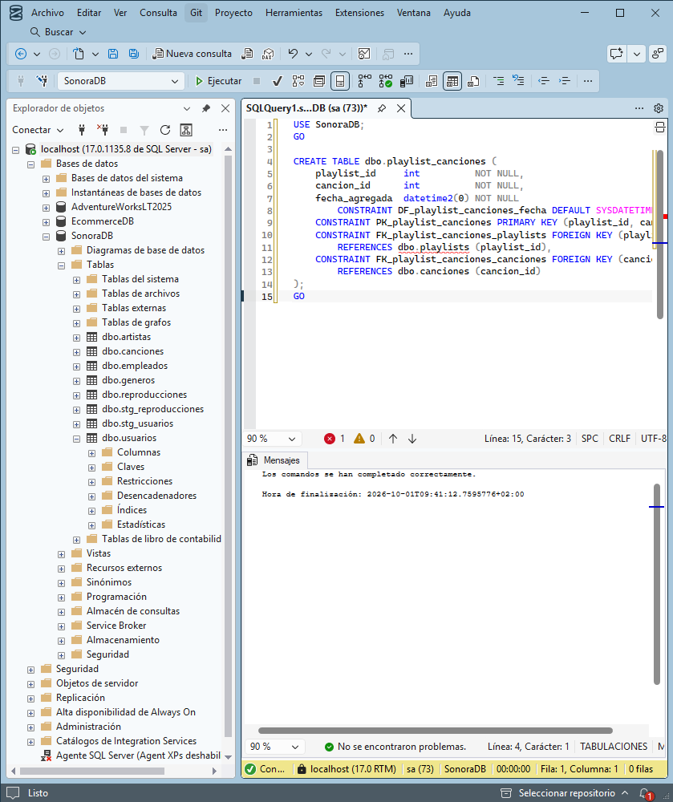

Es una tabla puente entre `playlists` y `canciones`. La clave primaria compuesta impide repetir la misma canción dentro de una playlist.

### Ejercicio 31 · Cambios con `ALTER TABLE`

> Añadir la columna opcional `descripcion` de tipo `nvarchar(200)` y una restricción que obligue a que el nombre tenga al menos 3 caracteres. Comprueba el resultado consultando `INFORMATION_SCHEMA.COLUMNS` para la tabla `playlists`.

```sql
ALTER TABLE dbo.playlists
    ADD descripcion nvarchar(200) NULL;
GO

ALTER TABLE dbo.playlists
    ADD CONSTRAINT CK_playlists_nombre_longitud CHECK (LEN(nombre) >= 3);
GO

SELECT COLUMN_NAME, DATA_TYPE, IS_NULLABLE
FROM INFORMATION_SCHEMA.COLUMNS
WHERE TABLE_NAME = 'playlists'
ORDER BY ORDINAL_POSITION;
GO
```

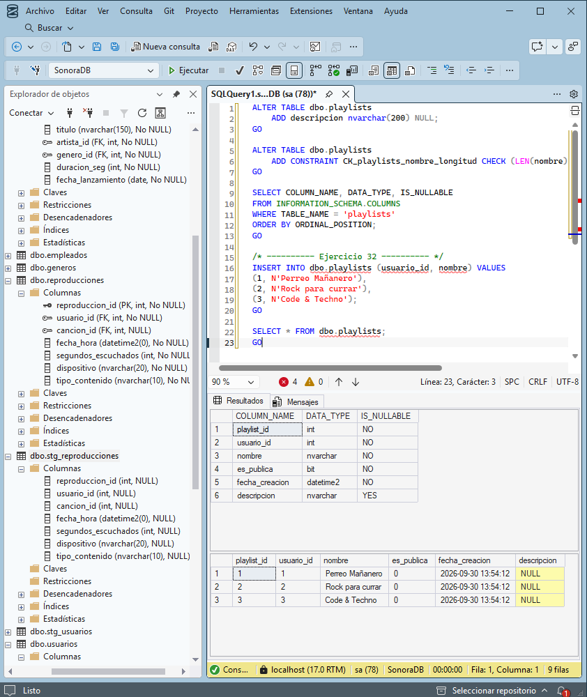

La captura recoge en la misma pantalla este ejercicio (primer resultado, con las 6 columnas de `playlists`) y el siguiente (segundo resultado, con las tres playlists insertadas). La nueva columna `descripcion` es opcional (`IS_NULLABLE = YES`).

---

## 7. DML: insertar, actualizar y borrar

### Ejercicio 32 · Insertar las tres playlists

> Inserta en una sola instrucción estas tres playlists, sin indicar `playlist_id`, `es_publica` ni `fecha_creacion`. Después consulta la tabla.

```sql
INSERT INTO dbo.playlists (usuario_id, nombre) VALUES
(1, N'Perreo Mañanero'),
(2, N'Rock para currar'),
(3, N'Code & Techno');
GO

SELECT * FROM dbo.playlists;
GO
```


`playlist_id` lo genera `IDENTITY` (1, 2 y 3), `es_publica` toma su valor por defecto 0 y `fecha_creacion` toma la fecha y hora de ejecución (`SYSDATETIME()`). `descripcion` queda a `NULL`.

### Ejercicio 33 · Añadir canciones a las playlists

> A la playlist 1, las canciones 103, 104 y 113; a la playlist 2, las canciones 106, 107 y 110, con un `INSERT` de varias filas en cada caso. A la playlist 3, todas las canciones de los géneros `House` y `Techno`, con un `INSERT ... SELECT` que use un `JOIN` con `generos`.

```sql
INSERT INTO dbo.playlist_canciones (playlist_id, cancion_id) VALUES
(1, 103), (1, 104), (1, 113);
GO

INSERT INTO dbo.playlist_canciones (playlist_id, cancion_id) VALUES
(2, 106), (2, 107), (2, 110);
GO

INSERT INTO dbo.playlist_canciones (playlist_id, cancion_id)
SELECT 3, c.cancion_id
FROM dbo.canciones AS c
INNER JOIN dbo.generos AS g ON g.genero_id = c.genero_id
WHERE g.nombre IN (N'House', N'Techno');
GO
```

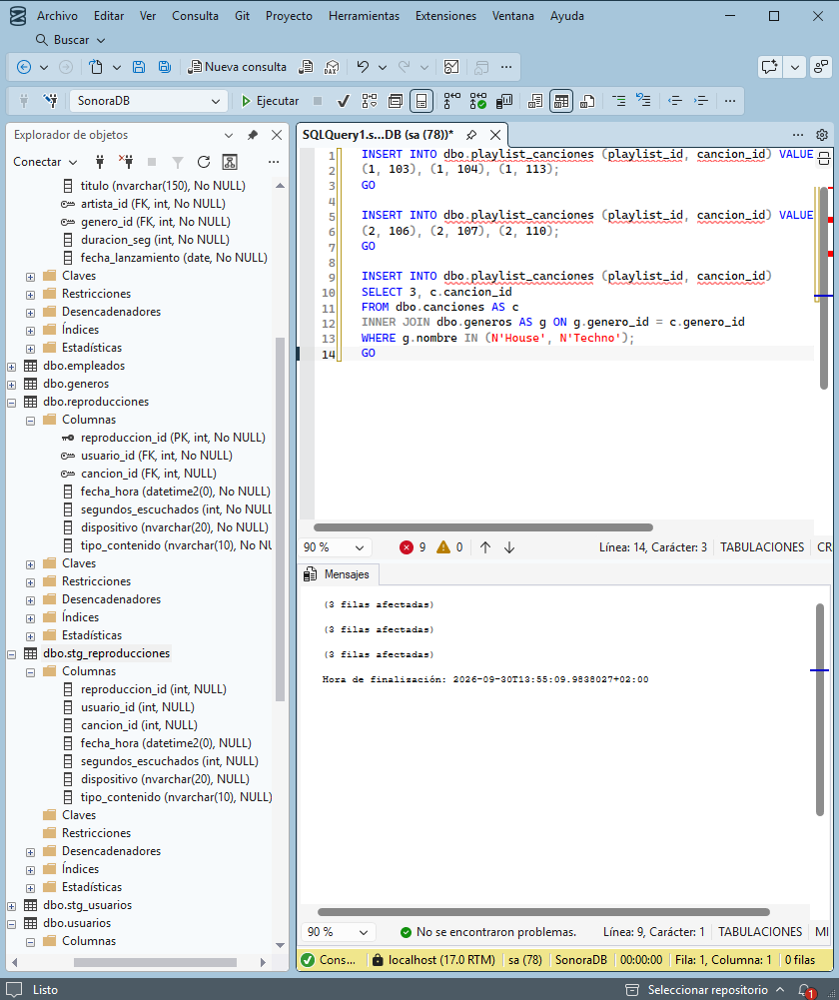

Cada instrucción afecta a 3 filas, por lo que `playlist_canciones` queda con 9. En la tercera no se escriben los ids a mano: el `SELECT` los obtiene de las canciones cuyo género es House o Techno (105, 111 y 115).

### Ejercicio 34 · Las restricciones protegen los datos

> Comprueba que las restricciones protegen los datos. Ejecuta cada intento por separado, anota el número de error y qué restricción lo provoca.

**Intento 1.** Añadir otra vez la canción 103 a la playlist 1:

```sql
INSERT INTO dbo.playlist_canciones (playlist_id, cancion_id) VALUES (1, 103);
```


**Intento 2.** Añadir la canción 999 a la playlist 1:

```sql
INSERT INTO dbo.playlist_canciones (playlist_id, cancion_id) VALUES (1, 999);
```


**Intento 3.** Crear una playlist para alexbeats llamada `AB`:

```sql
INSERT INTO dbo.playlists (usuario_id, nombre) VALUES (1, N'AB');
```

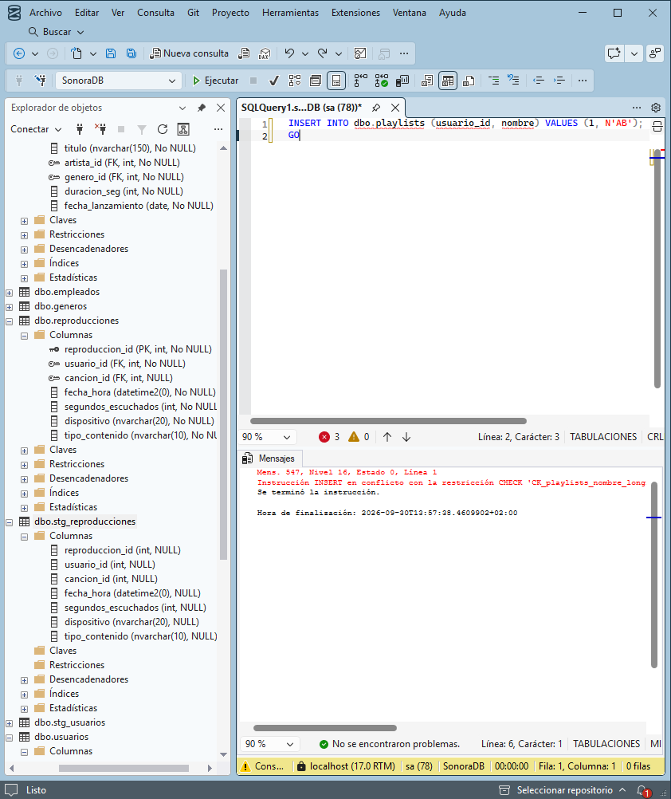

**Intento 4.** Crear otra playlist para alexbeats llamada `Perreo Mañanero`:

```sql
INSERT INTO dbo.playlists (usuario_id, nombre) VALUES (1, N'Perreo Mañanero');
```

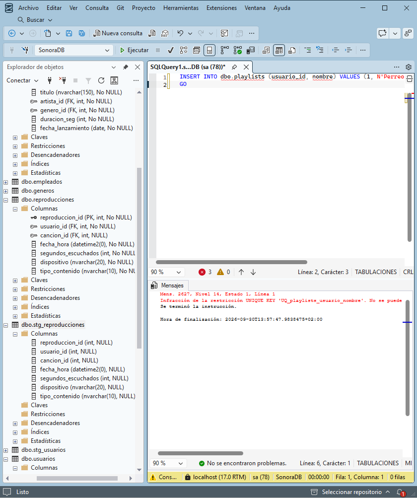

| Intento | Error | Restricción | Motivo |
| --- | --- | --- | --- |
| 1 | Msg 2627 | `PK_playlist_canciones` | Violación de la clave primaria: la canción 103 ya está en la playlist 1 |
| 2 | Msg 547 | `FK_playlist_canciones_canciones` | Conflicto con la clave foránea: la canción 999 no existe en `canciones` |
| 3 | Msg 547 | `CK_playlists_nombre_longitud` | Conflicto con la restricción CHECK: `AB` tiene menos de 3 caracteres |
| 4 | Msg 2627 | `UQ_playlists_usuario_nombre` | Violación de la restricción UNIQUE: alexbeats ya tiene una playlist con ese nombre |

Los intentos 3 y 4 fallan, pero consumen valores de la columna `IDENTITY`: si ahora se insertara una playlist válida, recibiría un id mayor que 4. `IDENTITY` no garantiza números consecutivos.

### Ejercicio 35 · Actualizaciones

> Añade a la playlist 2 la descripción `Guitarras para la oficina`. Con un `UPDATE` que haga `JOIN` con `usuarios`, haz públicas todas las playlists cuyo dueño tenga plan `Premium`.

```sql
UPDATE dbo.playlists
SET descripcion = N'Guitarras para la oficina'
WHERE playlist_id = 2;
GO

UPDATE p
SET p.es_publica = 1
FROM dbo.playlists AS p
INNER JOIN dbo.usuarios AS u ON u.usuario_id = p.usuario_id
WHERE u.plan_suscripcion = N'Premium';
GO
```

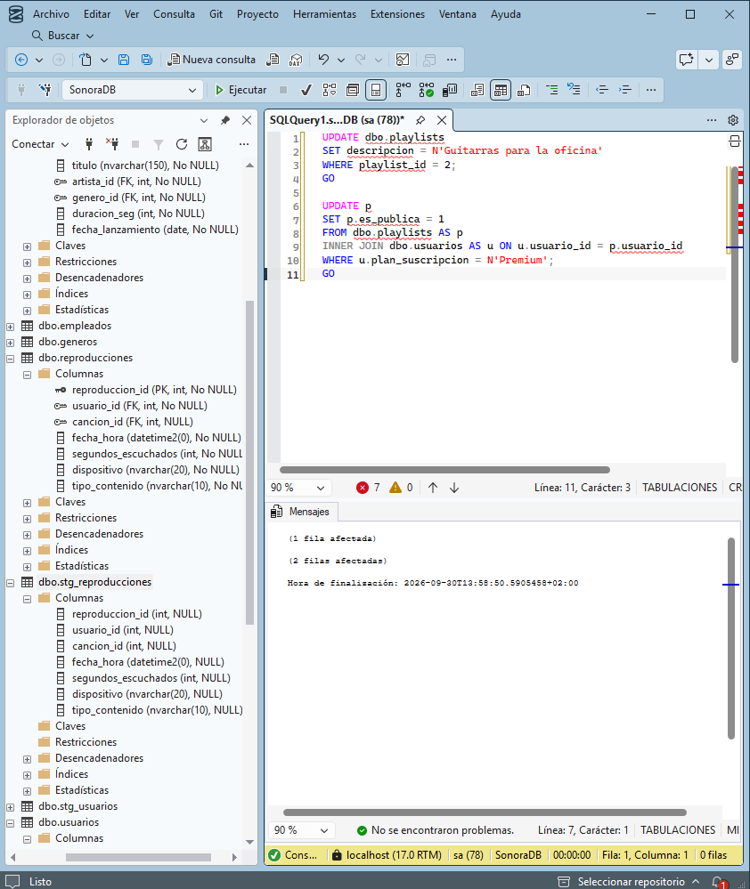

La primera actualización afecta a 1 fila y la segunda a 2 (las playlists 1 y 3, de alexbeats y juanpi, que tienen plan Premium).

### Ejercicio 36 · Resumen de playlists

> Obtén un resumen de las playlists: id, dueño, nombre, si es pública y número de canciones. Ordena por id.

```sql
SELECT p.playlist_id,
       u.nombre_usuario,
       p.nombre,
       p.es_publica,
       COUNT(pc.cancion_id) AS num_canciones
FROM dbo.playlists AS p
INNER JOIN dbo.usuarios AS u ON u.usuario_id = p.usuario_id
LEFT  JOIN dbo.playlist_canciones AS pc ON pc.playlist_id = p.playlist_id
GROUP BY p.playlist_id, u.nombre_usuario, p.nombre, p.es_publica
ORDER BY p.playlist_id;
```

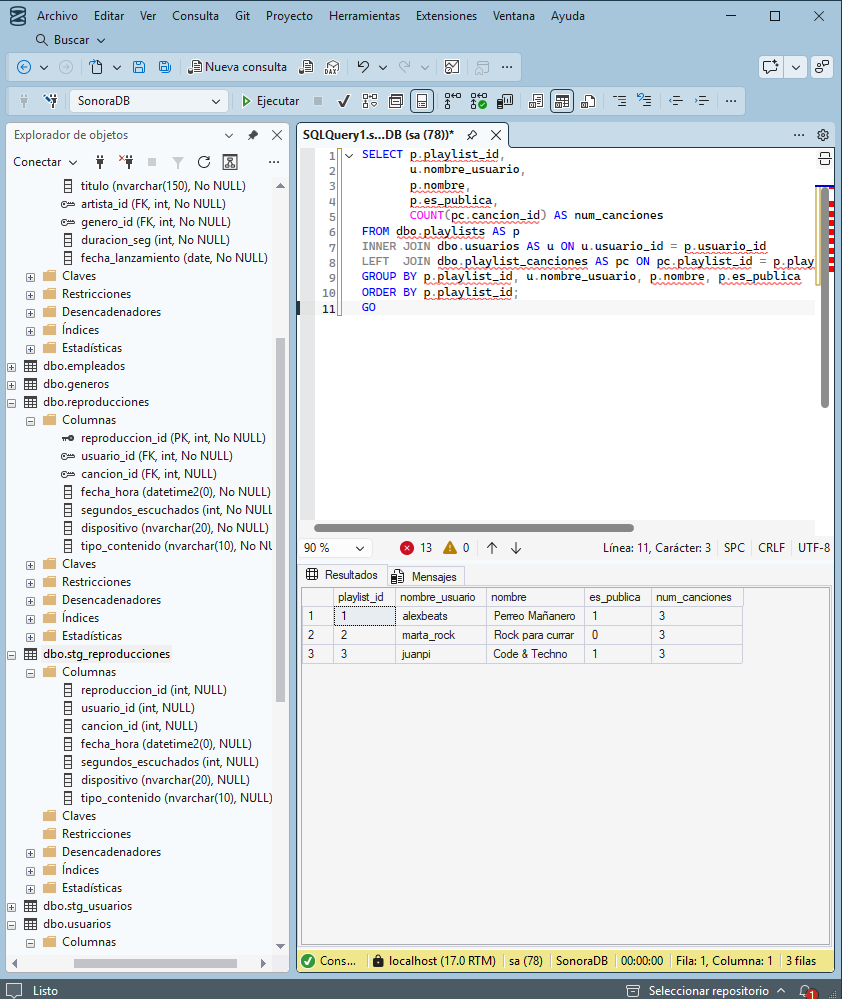

Se usa `LEFT JOIN` con `COUNT(pc.cancion_id)` para que una playlist sin canciones apareciera con 0 en lugar de desaparecer.

### Ejercicio 37 · Borrados

> 1. Quita la canción `Forja` (110) de la playlist 2. 2. Intenta borrar la playlist 3 directamente. Anota el error. 3. Borra la playlist 3 correctamente, en el orden necesario.

**Paso 1.** Quitar `Forja` de la playlist 2:

```sql
DELETE FROM dbo.playlist_canciones
WHERE playlist_id = 2 AND cancion_id = 110;
```

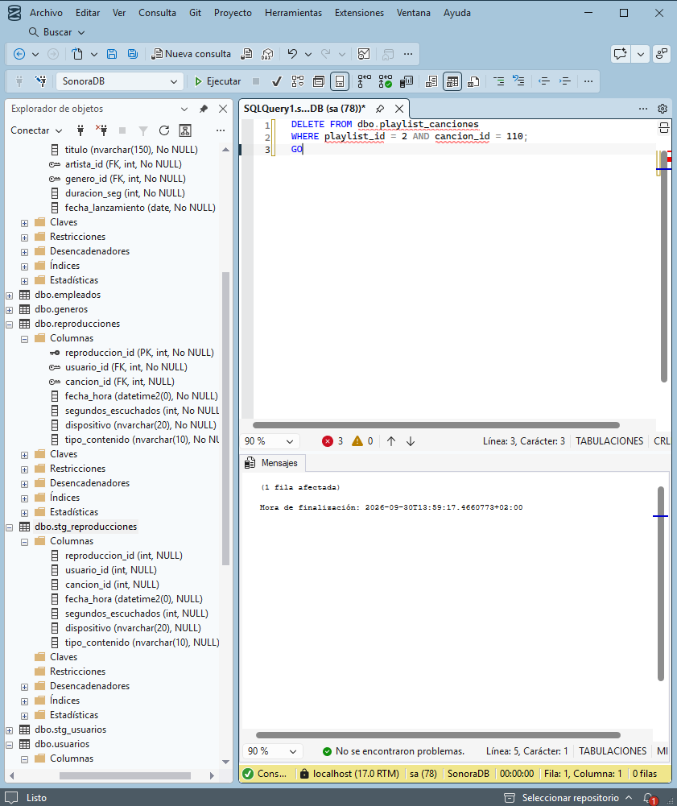

**Paso 2.** Intento de borrar la playlist 3 directamente:

```sql
DELETE FROM dbo.playlists WHERE playlist_id = 3;
```

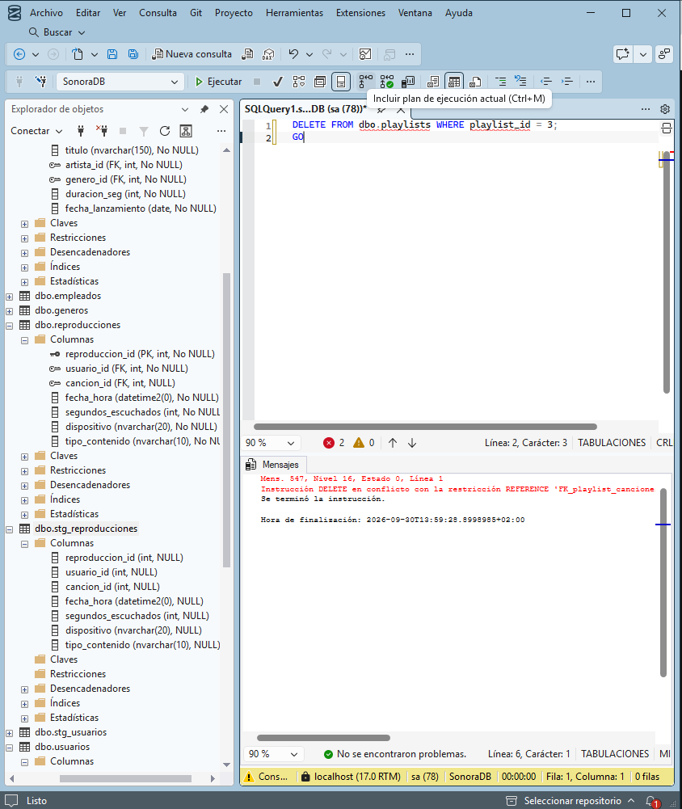

Falla con el **Msg 547**: la sentencia `DELETE` entra en conflicto con la restricción `REFERENCE` (`FK_playlist_canciones_playlists`), porque `playlist_canciones` todavía tiene filas que apuntan a la playlist 3. No se puede borrar una fila de la tabla madre mientras existan filas hijas que la referencian.

**Paso 3.** Borrado en el orden correcto, primero las filas hijas y después la playlist:

```sql
DELETE FROM dbo.playlist_canciones WHERE playlist_id = 3;
DELETE FROM dbo.playlists          WHERE playlist_id = 3;
```

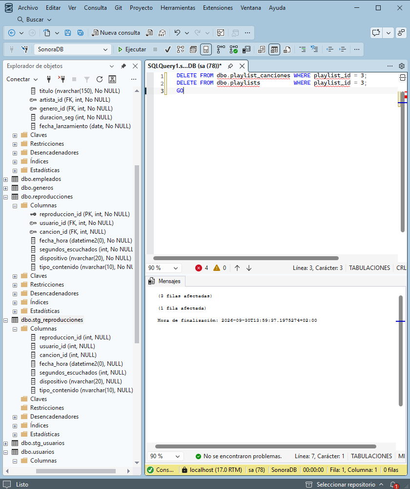

### Ejercicio 38 · Transacción con `ROLLBACK`

> Soporte quiere probar qué pasaría si marta_rock (usuario 2) pasara a Premium, sin que el cambio quede guardado. Dentro de una transacción explícita, actualiza su plan, consulta el valor, deshaz el cambio y vuelve a consultarlo.

```sql
BEGIN TRAN;

UPDATE dbo.usuarios
SET plan_suscripcion = N'Premium'
WHERE usuario_id = 2;

SELECT plan_suscripcion FROM dbo.usuarios WHERE usuario_id = 2;   -- Premium (dentro de la transacción)

ROLLBACK;

SELECT plan_suscripcion FROM dbo.usuarios WHERE usuario_id = 2;   -- Free (tras el ROLLBACK)
GO
```

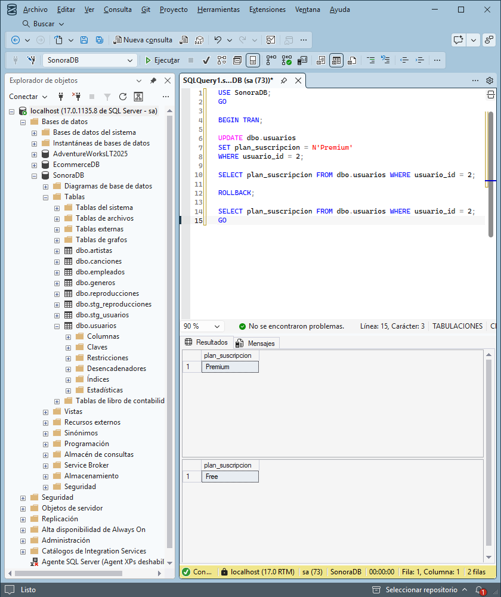

| Momento | plan_suscripcion |
| --- | --- |
| Dentro de la transacción, tras el `UPDATE` | Premium |
| Después del `ROLLBACK` | Free |

Dentro de la transacción la consulta ve el cambio sin confirmar; `ROLLBACK` lo deshace y el plan vuelve a ser `Free`. Sin `BEGIN TRAN` el `UPDATE` se confirmaría automáticamente y `ROLLBACK` daría error.

### Ejercicio 39 · Dejar `SonoraDB` como estaba

> Elimina las tablas `playlist_canciones` y `playlists` en el orden correcto y de forma que el script no falle si ya no existen. Comprueba con `sys.tables` que vuelven a quedar las 8 tablas del Ejercicio 2.

```sql
DROP TABLE IF EXISTS dbo.playlist_canciones;
DROP TABLE IF EXISTS dbo.playlists;
GO

SELECT name
FROM sys.tables
ORDER BY name;
GO
```


Primero se elimina `playlist_canciones` (la tabla hija, que tiene claves foráneas hacia `playlists`) y después `playlists`. `DROP TABLE IF EXISTS` evita el error si la tabla ya no existe. Al final quedan las 8 tablas originales.
